# FinSight: Cloud-Based Personal Finance Intelligence & Expense Analytics Platform

<div align="center">

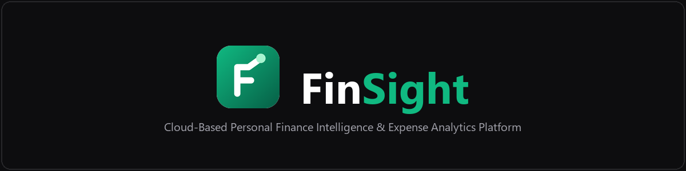

<br/>

[](https://zkht2b4ib3.execute-api.ap-south-1.amazonaws.com)
[](#system-architecture)
[](#technology-stack)
[](#technology-stack)
[](#aws-services)
[](#data-model)

<br/>

Cloud-based personal finance intelligence platform featuring exact integer-arithmetic expense tracking, automated budget projection alerts, robust statistical anomaly detection, smart OCR receipt scanning with human-in-the-loop review, What-If scenario simulations, and a deterministic conversational finance assistant.

<br/>

**Developed by Aakar Gupta**

</div>

---

## Contents

1. [Overview](#overview)
2. [Screenshots](#screenshots)
3. [Key features](#key-features)
4. [Technology stack](#technology-stack)
5. [System architecture](#system-architecture)
6. [Application workflow](#application-workflow)
7. [Data model](#data-model)
8. [AWS services](#aws-services)
9. [Security and privacy](#security-and-privacy)
10. [Local setup](#local-setup)
11. [Testing](#testing)
12. [AWS deployment](#aws-deployment)
13. [Cost considerations](#cost-considerations)
14. [Known limitations](#known-limitations)
15. [Project structure](#project-structure)
16. [Documentation and evidence](#documentation-and-evidence)
17. [Author and project information](#author-and-project-information)
18. [License](#license)

---

## Overview

> **Status (verified 2026-10-16):** Live at **<https://zkht2b4ib3.execute-api.ap-south-1.amazonaws.com>** — stack `finance-intelligence-prod`, `UPDATE_COMPLETE`. The latest live runs passed **64/64** API, authentication, storage and OCR checks and **27/27** browser checks. The web app is served through **API Gateway + Lambda**: CloudFront is in the template but **not deployed**, pending account verification by AWS Support.

**The problem.** People record spending in scattered places (payment apps, notes, paper receipts) and rarely see *why* their
money moves. Basic trackers list transactions but do not explain trends, warn before a budget is exhausted, or connect
spending to savings goals. Tools that do "smart" analysis often depend on bank connections or opaque, paid AI services.

**What FinSight does.** It records expenses exactly (integer paise, no floating-point drift) and turns them into explained
feedback: like-for-like month comparisons, budget projections while there is still time to act, robust anomaly flags, a
receipt scanner with human review, a What-If simulator and a rule-based assistant. Each insight is labelled as a **fact,
estimate, projection, recommendation or data gap** and carries its period, formula, values and supporting transactions.

**Intended users.** Individuals and students who want to understand and control their spending without linking a bank
account; evaluators of the project as an AWS cloud-architecture case study.

**Why it is technically meaningful.**

- One layered codebase (routes → services → repository) runs locally on SQLite and in AWS on DynamoDB, switched only by configuration.
- A serverless, pay-per-use AWS design with no idle servers: API Gateway HTTP API, nine Lambda functions (one an OCR container image), a single-table DynamoDB design, private S3 with presigned URLs, and Cognito.
- Defence in depth: the API Gateway JWT authorizer, then backend re-verification against JWKS and a Cognito `GetUser` revocation check, with the user id taken only from the verified token.
- It was deployed and tested end to end on real AWS, which surfaced and fixed three real-world issues (native-wheel packaging, a regional S3 redirect, and token revocation).

## Screenshots

Genuine screenshots of the **live** deployment (headless Chrome on the live URL, synthetic test user, 2026-10-16).
The full, indexed set — including local captures, animation frames, AWS evidence and test output — is in
[docs/evidence/SCREENSHOT_INDEX.md](docs/evidence/SCREENSHOT_INDEX.md).

<table>
<tr>
<td width="50%">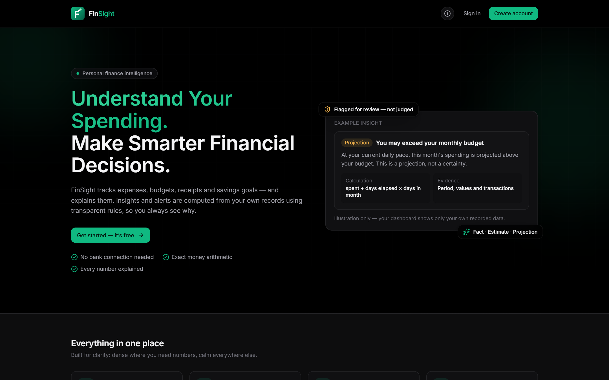<br><sub><b>Landing page</b></sub></td>
<td width="50%">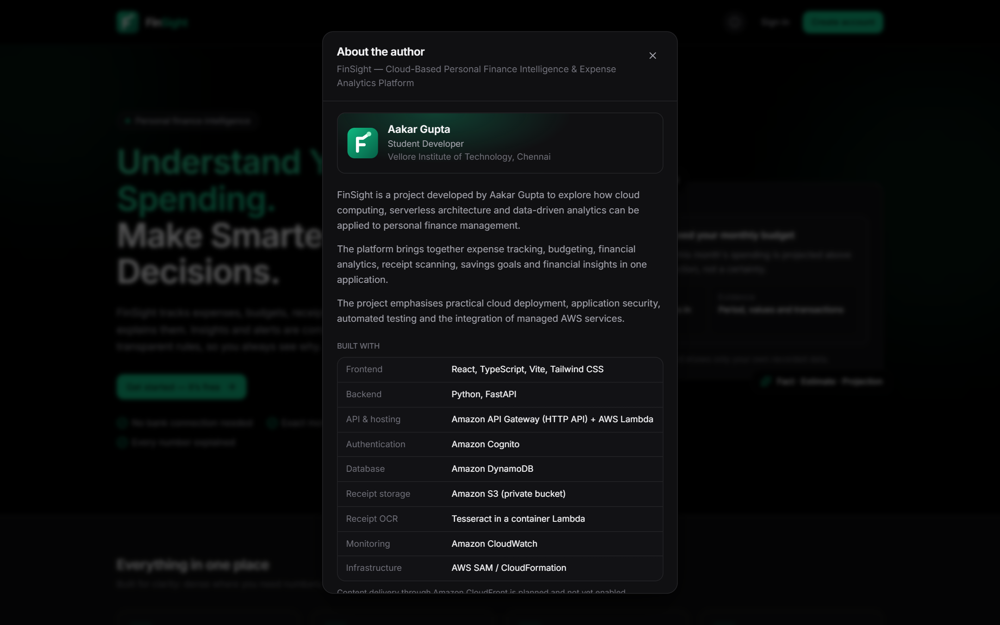<br><sub><b>About the author dialog</b></sub></td>
</tr>
<tr>
<td>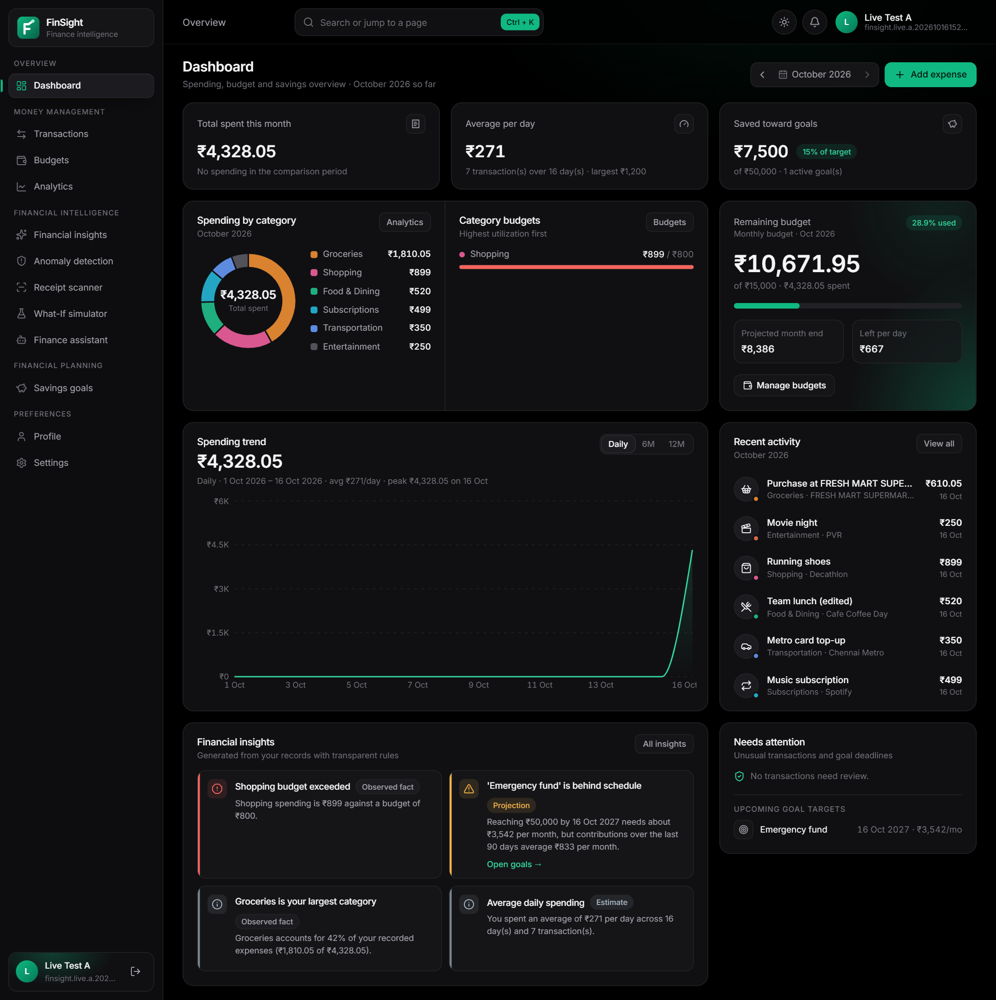<br><sub><b>Dashboard</b> (after Cognito sign-in; data from DynamoDB)</sub></td>
<td>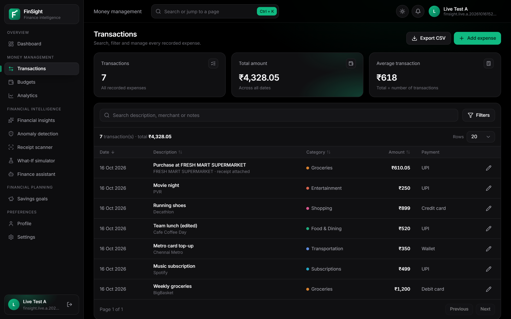<br><sub><b>Transactions</b></sub></td>
</tr>
<tr>
<td>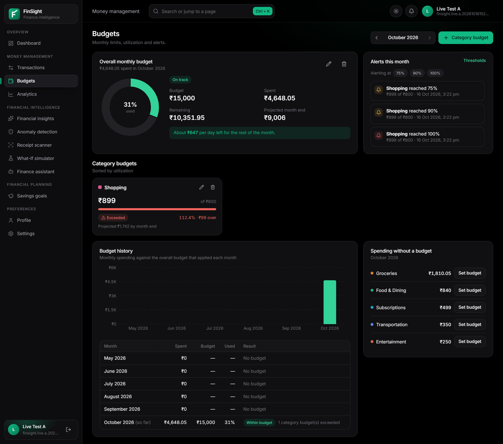<br><sub><b>Budgets</b> (utilization and thresholds)</sub></td>
<td>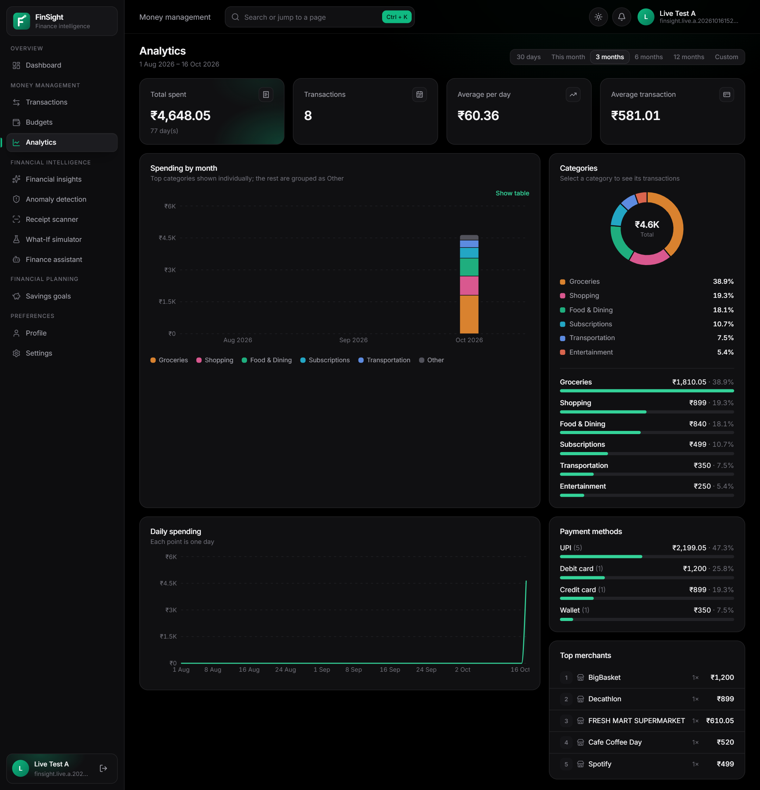<br><sub><b>Analytics</b></sub></td>
</tr>
<tr>
<td>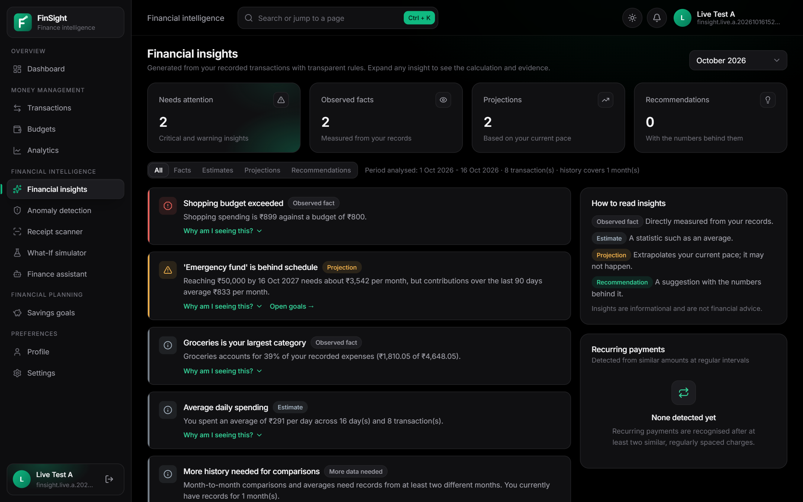<br><sub><b>Financial insights</b> with evidence</sub></td>
<td>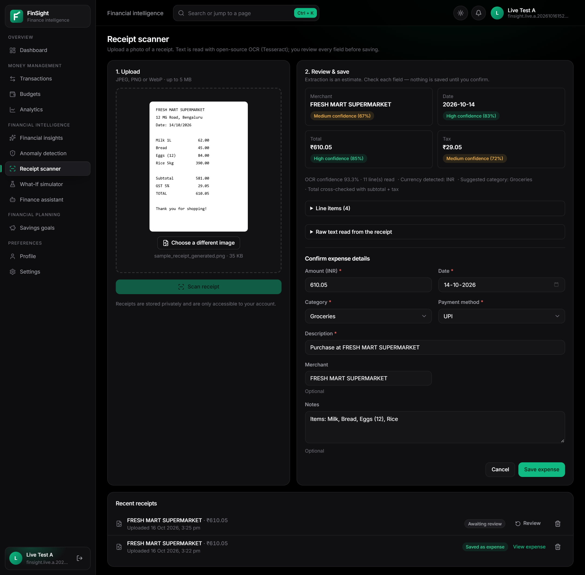<br><sub><b>Receipt scanner</b>: S3 upload, Tesseract OCR in Lambda, review</sub></td>
</tr>
<tr>
<td>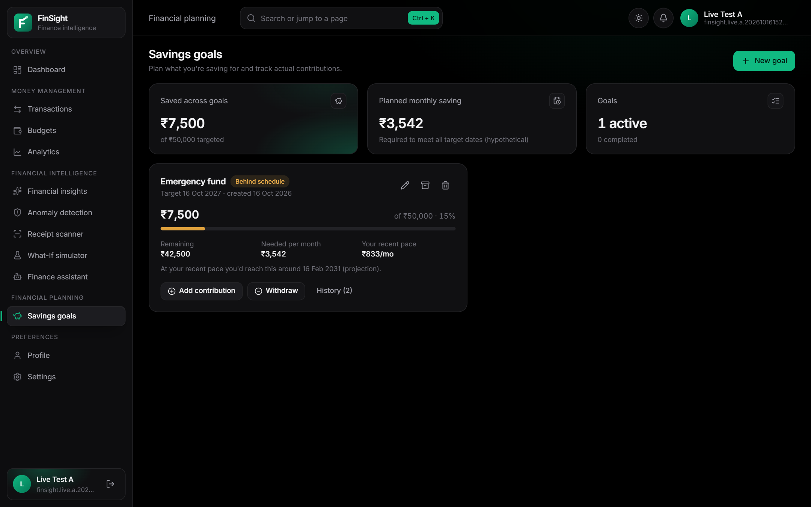<br><sub><b>Savings goals</b></sub></td>
<td>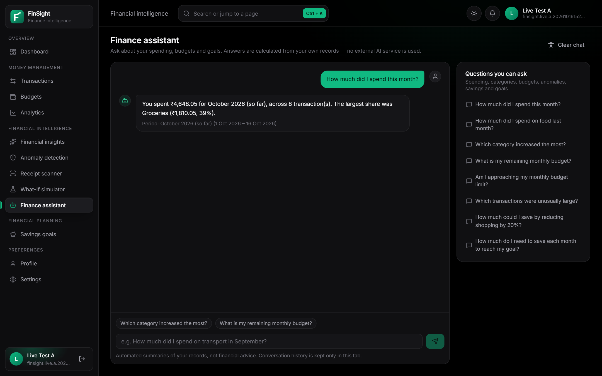<br><sub><b>Finance assistant</b></sub></td>
</tr>
</table>

## Key features

All features below are implemented and were verified locally and on the live deployment (evidence IDs in
[docs/reports/markdown/AWS_LIVE_TEST_RESULTS.md](docs/reports/markdown/AWS_LIVE_TEST_RESULTS.md)).

| Feature | What it does |
|---|---|
| **Expenses** | Create, view, edit, delete; search; filter by date, category, payment method and amount; sort; paginate; CSV export; notes, merchant and an attached receipt. Totals cover all matching records |
| **Categories and payment methods** | Built-in and custom categories (removing one moves its expenses to *Other*); UPI, cards, cash, net banking, wallet, other |
| **Budgets** | Overall and per-category monthly budgets; utilization, remaining, projected month-end spend, daily allowance; thresholds (default 75/90/100 %) alerted once each per month; versioned history |
| **Dashboard and analytics** | KPIs with like-for-like comparison, category donut, budget card, spending trend, recent activity, insights and alerts; analytics over preset and custom ranges with daily, monthly, category, payment-method and merchant views |
| **Financial insights** | Rule-based engine: month-over-month and category changes, concentration, averages, projections, recurring payments, goal pace, recommendations — each with its evidence (“Why am I seeing this?”) |
| **Anomaly detection** | Median/MAD modified z-scores per category, a conservative overall rule for thin history, duplicates, repeated same-day charges, category spikes; review as reviewed / legitimate / dismissed; never modifies transactions |
| **Receipt scanner** | JPEG/PNG/WebP ≤ 5 MB; validation, Pillow preprocessing, **Tesseract** OCR, parser for merchant, date, total, tax, currency and line items with per-field confidence; the user corrects and confirms before an expense is created |
| **What-If simulator** | Up to four scenarios of percentage, fixed or target changes per category; monthly and annual savings, budget and goal impact; never writes real records |
| **Savings goals** | Target, date, contributions and withdrawals, required monthly saving, recent pace, status (on track / behind / overdue / completed) |
| **Finance assistant** | Rule-based natural-language questions over 14 intents (totals, top category, budget remaining, unusual transactions, goal requirement, …) with clarification for ambiguous periods |
| **Authentication and isolation** | Cognito sign-up, sign-in, refresh and sign-out on AWS (local email/password + JWT for development); every record scoped to the token's user id; other users' ids return 404 |
| **Profile, settings, About** | Name, currency, timezone, thresholds, anomaly sensitivity, custom categories, dark (default) / light theme, labelled demo data, delete all data; “Created by Aakar Gupta” footer credit and an *About the author* dialog |
| **Responsive, animated UI** | Mobile drawer below 1024 px; page, chart, number and dialog animations that respect `prefers-reduced-motion` |

**Not supported by design:** income tracking, bank connections, investments, multi-currency conversion and financial advice.

## Technology stack

| Technology | Purpose | Implementation details |
|---|---|---|
| React ^19.3, TypeScript ^7.0, Vite ^8.3 | Single-page application | 16 lazily loaded routes; one API client (`lib/api.ts`) |
| Tailwind CSS ^4.3, Inter | Styling and theming | Design tokens for dark (default) and light themes |
| Recharts ^3.10, Radix Dialog, Sonner, Lucide | Charts, dialogs, toasts, icons | Accessible charts with table views |
| React Hook Form ^7.90 + Zod ^4.6 | Forms | Client validation that mirrors the server rules |
| Python + FastAPI ≥0.115 + Pydantic v2 | REST API (`/api/v1`) | Python 3.14 locally, 3.13 on Lambda; unknown fields rejected |
| Mangum ≥0.19 | Lambda adapter | The same FastAPI app serves API Gateway events, one route group per function |
| SQLite · Amazon DynamoDB | Persistence | One `Repository` interface, two implementations, same test suite |
| Tesseract 5 + pytesseract, Pillow | Receipt OCR | Tesseract 5.4 locally, 5.5 in the Lambda container image |
| scrypt + PyJWT · Amazon Cognito | Authentication | Local HS256 JWT; Cognito RS256 tokens verified against JWKS |
| AWS SAM / CloudFormation | Infrastructure as code | `infra/template.yaml`, deployed with change-set review |
| pytest, httpx, moto · Vitest, Testing Library | Testing | Unit, API, security, AWS-path (mocked) and component tests |

## System architecture

The diagram shows the **deployed** architecture. CloudFront is not part of it (see [AWS deployment](#aws-deployment)).

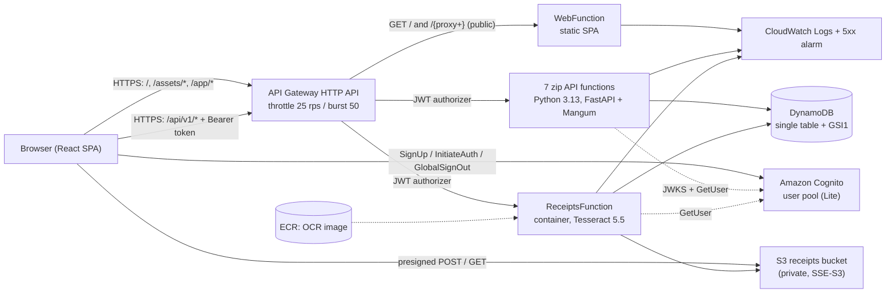

- The SPA and the API share **one origin**, so the browser makes no cross-origin API calls. The only cross-origin calls go to
  Cognito and to S3 through short-lived presigned URLs.
- The backend is layered: **routes** (HTTP, auth context) → **services** (business logic, storage-independent) →
  **repository** (SQLite or DynamoDB). Each Lambda builds only its own route group, so it gets only the IAM permissions it needs.
- A rendered version of this diagram for print use is
  [docs/reports/report_assets/diagrams/fig_aws_architecture.svg](docs/reports/report_assets/diagrams/fig_aws_architecture.svg).

Details: [docs/reports/markdown/PROJECT_DOCUMENTATION.md §5–6](docs/reports/markdown/PROJECT_DOCUMENTATION.md#5-application-architecture).

## Application workflow

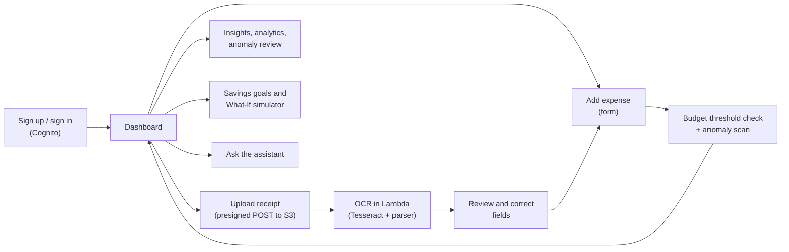

1. **Register and sign in** through Cognito (e-mail code confirmation); the SPA keeps tokens in `sessionStorage` and refreshes them.
2. **Record an expense** with the form; the server validates it, stores it, then runs the budget threshold check and the anomaly scan and returns any new alerts.
3. **Track budgets** on the Budgets page and the dashboard card: utilization, projection and one alert per threshold per month.
4. **Analyse** spending on the Analytics page; read **insights** with their evidence; review **anomaly** flags.
5. **Scan a receipt:** the browser uploads the image directly to the private bucket, the OCR function extracts the fields, and the user corrects and confirms them to create a linked expense.
6. **Plan** with savings goals and the What-If simulator; ask the **assistant** questions in plain language.

## Data model

All access is per user. In AWS a single DynamoDB table is keyed by `PK = USER#<sub>`, so a query cannot reach another
user's partition; locally SQLite stores the same records with `WHERE user_id = ?` on every query.

| Entity | DynamoDB sort key | Purpose | Notes |
|---|---|---|---|
| Preferences | `PREFERENCES` | currency, timezone, thresholds, sensitivity, custom categories | one per user |
| Expense | `EXPENSE#<id>` | amount (integer paise), date, category, description, merchant, payment method, receipt link | `GSI1` (`USER#<sub>#EXPENSE`, `<date>#<id>`) serves date-range queries |
| Budget | `BUDGET#<id>` | overall (no category) or category budget | versioned by month (`effective_from` / `effective_to`) |
| Budget alert event | `BUDGETALERT#<month>#<key>#<threshold>` | one alert per threshold per month | conditional write |
| Goal | `GOAL#<id>` | target, date, embedded contributions | |
| Anomaly alert | `ANOMALY#<id>` (+ `ANOMALYKEY#<dedup>`) | rule, reason, comparison values, review status | transactional de-duplication |
| Receipt | `RECEIPT#<id>` | S3 key, status, extracted fields, linked expense | image in the private bucket |

Insights are computed on request and never stored. No `Scan` is used, and the IAM policy does not grant it. Full design:
[docs/reports/markdown/PROJECT_DOCUMENTATION.md §11](docs/reports/markdown/PROJECT_DOCUMENTATION.md#11-database-and-data-model).

## AWS services

| Service | Purpose in FinSight | Status |
|---|---|---|
| Amazon API Gateway (HTTP API) | Single HTTPS entry point for the SPA and `/api/v1`; Cognito JWT authorizer; throttling 25 rps / burst 50 | **Deployed** |
| AWS Lambda | 7 zip API functions (Python 3.13), `ReceiptsFunction` (container image with Tesseract), `WebFunction` (serves the SPA) | **Deployed** (9 functions) |
| Amazon DynamoDB | Single on-demand table with `GSI1`, SSE, DeletionPolicy Retain | **Deployed** |
| Amazon S3 | Private receipts bucket: Block Public Access, SSE-S3, TLS-only policy, POST-only CORS, presigned URLs | **Deployed** |
| Amazon Cognito | User pool (Lite), public app client without a secret; sign-up, sign-in, refresh, sign-out | **Deployed** |
| Amazon CloudWatch | 9 log groups (14-day retention), API 5xx alarm | **Deployed** |
| Amazon ECR | OCR container image (SAM-managed repository) | **Deployed** (outside the stack) |
| AWS IAM | One least-privilege role per function; shared table policy without `Scan` | **Deployed** |
| AWS SAM / CloudFormation | Infrastructure as code with change-set review | **Deployed** (stack + 2 companion stacks) |
| Amazon CloudFront (+ S3 web bucket, OAC) | CDN delivery of the SPA | **Planned** — in the template (`FrontendHosting=cloudfront`) but blocked by account verification |
| AWS WAF, Amazon SNS | Edge protection; alarm notifications | **Future** — not configured |
| SQLite, Uvicorn, Vite, local Tesseract | Local development | **Local only** |

## Security and privacy

| Control | Implementation |
|---|---|
| Authentication | Cognito on AWS; scrypt + HS256 JWT with pinned algorithm locally |
| Two-layer token checks | API Gateway JWT authorizer (signature, issuer, audience, expiry) → backend re-verification (RS256 via JWKS, `token_use = access`, `client_id`) → Cognito `GetUser` revocation check, cached 15 s, fail-open with a warning log |
| Authorization and isolation | User id only from the token's `sub`; every query scoped to the user; unknown request fields (e.g. `user_id`) → 422; other users' ids → 404. Verified live (ISO-01…03) |
| Receipt privacy | Private bucket, Block Public Access, SSE-S3, TLS-only; 5-minute presigned POST that fixes key, type, encryption and size (1 B–5 MB); 2-minute presigned GET; unsigned access → 403 |
| Upload safety | Magic-byte type check, full decode, size and pixel limits, server-generated keys, OCR timeout |
| IAM | Item-level DynamoDB actions on one table and its indexes; S3 object actions only on the receipts bucket; WebFunction has no AWS permissions; no wildcards |
| Token handling | Tokens in memory and `sessionStorage`, never in URLs or `localStorage`; 60-minute access tokens with refresh |
| Logging | Method, path, status, duration and request id only — no bodies, tokens, query strings or receipt text |
| Transport and headers | HTTPS only (no plain-HTTP listener); HSTS, `nosniff`, frame options, referrer policy; API docs disabled in production |

**Limitations:** revocation takes effect within 15 s and fails open if Cognito is unreachable; no Content-Security-Policy,
WAF or MFA yet; deployments used the root account (MFA on, no access keys). The full threat model and the review of the
deployed system are in [docs/reports/markdown/PROJECT_DOCUMENTATION.md §16](docs/reports/markdown/PROJECT_DOCUMENTATION.md#16-security).

## Local setup

Local mode uses **SQLite, local email/password authentication and a local receipt folder**. No AWS account or
configuration is needed.

**Prerequisites**

| Tool | Version | Notes |
|---|---|---|
| Python | 3.13 or later (developed on 3.14) | backend |
| Node.js / npm | Node 20+ (developed on 23.8), npm 10+ | frontend |
| Tesseract OCR | 5.x | receipt OCR only; the rest of the app works without it |
| AWS CLI v2, AWS SAM CLI, Docker Desktop | — | AWS deployment only |

Install Tesseract with `winget install --id UB-Mannheim.TesseractOCR` (Windows; detected automatically), `brew install tesseract`
(macOS) or `sudo apt-get install tesseract-ocr` (Debian/Ubuntu). Elsewhere, set `TESSERACT_CMD` in `backend/.env`.

**1. Get the code**

```bash
git clone <repository-url> finsight
cd finsight
```

**2. Backend** (terminal 1)

```bash
cd backend
python -m venv .venv
# Windows: .venv\Scripts\activate      macOS/Linux: source .venv/bin/activate
pip install -r requirements-dev.txt
uvicorn app.main:create_app --factory --port 8000 --reload
```

**3. Frontend** (terminal 2)

```bash
cd frontend
npm install
npm run dev
```

**4. Open the app** at <http://localhost:5173> (Vite proxies `/api` to port 8000). Interactive API docs:
<http://localhost:8000/api/docs>. Create an account, then choose **Explore with demo data** on the empty dashboard
(synthetic, labelled “Demo”, removable in one step).

**Configuration.** Defaults need no changes: SQLite at `backend/data/finance.db`, local auth (the signing secret is generated
on first start in the git-ignored `backend/data/.jwt_secret`), local receipts and demo data. To override settings, copy
the backend section of [.env.example](.env.example) to `backend/.env` (placeholders only — never commit real values).
The frontend needs no `.env` locally.

**Stop and reset.** Stop each server with `Ctrl+C`. To reset local data, stop the backend and delete `backend/data/`.

**Troubleshooting.** “FinSight is temporarily unavailable” means the backend is not reachable — start it on port 8000, or
run it on another port and start Vite with `API_PROXY_TARGET=http://127.0.0.1:<port>`. If the receipt scanner says OCR is
unavailable, install Tesseract or set `TESSERACT_CMD`. More cases:
[docs/reports/markdown/PROJECT_DOCUMENTATION.md §18](docs/reports/markdown/PROJECT_DOCUMENTATION.md#18-troubleshooting).

## Testing

| Suite | Command | Latest result (2026-10-16) |
|---|---|---|
| Backend (pytest: unit, API, security, AWS paths with moto) | `cd backend && python -m pytest` | **131 passed** |
| Frontend (Vitest) | `cd frontend && npm test` | **20 passed** (4 files) |
| Type check / production build | `npm run typecheck` / `npm run build` | pass / pass |
| Infrastructure lint | `cfn-lint infra/template.yaml` (and `sam validate --lint`) | pass |
| Live API, Cognito, DynamoDB, S3, OCR | `python infra/live_test.py --profile finsight` | **64/64 PASS** |
| Live browser (headless Chrome on the live URL) | `node docs/evidence/capture/live.mjs <live URL>` | **27/27**, 0 console errors, 0 failed requests |

No code-coverage percentage is claimed. Test map, live-test details and what was not tested:
[docs/reports/markdown/PROJECT_DOCUMENTATION.md §13](docs/reports/markdown/PROJECT_DOCUMENTATION.md#13-testing) and
[docs/reports/markdown/AWS_LIVE_TEST_RESULTS.md](docs/reports/markdown/AWS_LIVE_TEST_RESULTS.md).

## AWS deployment

**Prerequisites:** AWS CLI v2, AWS SAM CLI, Docker Desktop (running, for the OCR image), Python 3.13 on PATH, and a
signed-in CLI profile (`aws login --profile finsight`). No AWS credentials are stored in the repository; Lambda uses IAM roles.

**Configuration** (`infra/samconfig.toml`): stack `finance-intelligence-prod`, region `ap-south-1`, profile `finsight`,
`confirm_changeset = true`, parameters `Stage=prod`, `AllowDemoData=false`, **`FrontendHosting=apigateway`**.

```powershell
aws sts get-caller-identity --profile finsight      # confirm you are in the intended account
python infra/prepare_build.py                        # stage backend code, requirements.txt and the same-origin web bundle
cd infra
sam validate --lint
sam build
sam deploy                                           # review the change set, then confirm with "y"
cd ..
python infra/live_test.py --profile finsight         # live API checks (use backend\.venv\Scripts\python.exe on Windows)
node docs/evidence/capture/live.mjs https://zkht2b4ib3.execute-api.ap-south-1.amazonaws.com
```

- **Verify:** `GET /api/v1/health` returns `{"status":"ok","database":"ok",…,"data_backend":"dynamodb"}`; `GET /api/v1/expenses`
  without a token returns 401.
- **Logs:** `aws logs tail /aws/lambda/<function-name> --since 1h --profile finsight`.
- **Update:** change the code, then repeat `prepare_build.py`, `sam build` and `sam deploy`. The change-set review step
  prevents accidental resource replacement; every update so far was code-only.
- **CloudFront:** creation failed with *“Your account must be verified before you can add new CloudFront resources.”* After
  AWS Support enables it, set `FrontendHosting=cloudfront`, redeploy and run `python infra/deploy_frontend.py --profile finsight`.
- **Remove (only when the project is finished):** `sam delete --stack-name finance-intelligence-prod --profile finsight`, then
  delete the retained DynamoDB table and receipts bucket, the SAM artifact stack and the ECR repository manually. This
  permanently deletes all data.

Full procedure, permissions, rollback and deployment history:
[docs/reports/markdown/PROJECT_DOCUMENTATION.md §14](docs/reports/markdown/PROJECT_DOCUMENTATION.md#14-aws-deployment).

## Cost considerations

There are no always-on resources (no EC2, RDS, NAT gateway, load balancer or public IPv4). Charges can come from
API Gateway requests, Lambda duration (mainly the 1024 MB OCR function), DynamoDB requests and storage, S3 storage and
requests, **ECR image storage** (three versions, about 0.38 GB — the largest idle cost), CloudWatch log ingestion, and Cognito
users beyond the free tier.

On 2026-10-16 the account was on the AWS **Free plan** with US$159.91 of credits (plan expiry 2027-02-28); the Billing
console showed US$0.09 of credits used (estimated). Assuming demonstration use (≤ 5,000 API requests, ≤ 50 OCR runs and
< 10 MB of data per month), the estimate is **about US$0.05–0.10 per month**. This is an estimate, not a guarantee: real cost
depends on traffic, compute, storage, logs and ap-south-1 prices. AWS Budgets alerts notify; they do not cap spending.
Details: [docs/reports/markdown/PROJECT_DOCUMENTATION.md §17](docs/reports/markdown/PROJECT_DOCUMENTATION.md#17-cost).

## Known limitations

| Limitation | Workaround / current behaviour | Planned improvement |
|---|---|---|
| CloudFront not deployed (account verification pending) | SPA served by `WebFunction` on the HTTP API over HTTPS (no edge caching) | AWS Support case, then `FrontendHosting=cloudfront`; add WAF |
| Revocation after sign-out within 15 s; fail-open if Cognito is unreachable | Token still valid by signature and expiry (≤ 60 min) in that case | Shorter tokens or Cognito Essentials refresh-token rotation |
| Cold starts (~3 s zip, ~15 s first OCR start) | Warm requests take 15–130 ms | Provisioned concurrency only if needed (costs money) |
| No CSP header, SNS alarm target or DynamoDB PITR | — | Add for real users |
| Root account used for deployment (MFA, no keys) | — | IAM Identity Center administrator |
| One currency, no income or bank import; OCR is heuristic (printed English receipts, no PDFs); rule-based assistant (14 intents) | Fields are always reviewed before saving | Statement import, better OCR preprocessing |

## Project structure

```text
.
├── backend/
│   ├── app/
│   │   ├── main.py, config.py        FastAPI app factory and environment settings
│   │   ├── api/routes/               HTTP layer (expenses, budgets, analytics, anomalies, receipts, planning, assistant, account, auth)
│   │   ├── auth/                     password hashing, local JWT, Cognito JWKS + GetUser checks
│   │   ├── domain/                   models, money (integer minor units), dates, categories
│   │   ├── repositories/             base interface, sqlite_repo, dynamodb_repo
│   │   ├── services/                 business logic incl. insights, anomalies, simulator, goals, assistant/, receipts/
│   │   └── handlers/                 Lambda entry points (Mangum), one per route group
│   ├── tests/                        pytest suite (131 tests)
│   ├── Dockerfile.receipts           OCR Lambda container image
│   └── requirements.txt, requirements-dev.txt
├── frontend/
│   ├── src/pages/                    16 routes (landing, auth, dashboard, transactions, …)
│   ├── src/components/               UI primitives, charts, layout, About dialog
│   ├── src/lib/                      API client, auth (local/Cognito), formatting, motion
│   └── public/, scripts/             icons and the icon generator
├── infra/
│   ├── template.yaml, samconfig.toml AWS SAM template and deployment configuration
│   ├── prepare_build.py              stages Lambda code and the web bundle
│   ├── deploy_frontend.py            CloudFront-mode SPA publish (not used while CloudFront is blocked)
│   ├── live_test.py                  live API / Cognito / S3 / OCR test suite
│   ├── web/handler.py                WebFunction (static SPA server)
│   └── budgets/                      AWS Budgets alert definitions
├── docs/                             report, presentation, documentation, evidence and report assets
├── .env.example                      configuration placeholders
└── README.md
```

## Documentation and evidence

| Document | Contents |
|---|---|
| [docs/reports/markdown/PROJECT_DOCUMENTATION.md](docs/reports/markdown/PROJECT_DOCUMENTATION.md) | Full technical documentation: architecture, AWS, API, data model, OCR, testing, deployment, security review, cost review, troubleshooting, history |
| [docs/handover/HANDOVER.md](docs/handover/HANDOVER.md) | Current status, run commands, remaining manual actions |
| [docs/viva/AWS_VIVA_GUIDE.md](docs/viva/AWS_VIVA_GUIDE.md) ([PDF](docs/pdfs/AWS_VIVA_GUIDE.pdf)) | AWS syllabus cheat sheet (8 modules) and 150 project viva questions with answers |
| [docs/pdfs/PROJECT_REPORT_FINAL.pdf](docs/pdfs/PROJECT_REPORT_FINAL.pdf) ([DOCX](docs/reports/PROJECT_REPORT_FINAL.docx)) | Final academic report |
| [docs/pdfs/PROJECT_PRESENTATION_FINAL.pdf](docs/pdfs/PROJECT_PRESENTATION_FINAL.pdf) ([PPTX](docs/presentations/PROJECT_PRESENTATION_FINAL.pptx)) | Final presentation |
| [docs/reports/markdown/AWS_LIVE_TEST_RESULTS.md](docs/reports/markdown/AWS_LIVE_TEST_RESULTS.md) | Every live check with expected and actual results |
| [docs/evidence/SCREENSHOT_INDEX.md](docs/evidence/SCREENSHOT_INDEX.md) | Index of all screenshots and test evidence |
| [docs/reports/REPORT_ASSET_INDEX.md](docs/reports/REPORT_ASSET_INDEX.md) | Every figure used in the report and its source |
| [docs/reports/markdown/FINAL_VALIDATION.md](docs/reports/markdown/FINAL_VALIDATION.md) | Final validation summary (links to report and presentation validation) |
| [docs/reports/markdown/WORKSPACE_CLEANUP_REPORT.md](docs/reports/markdown/WORKSPACE_CLEANUP_REPORT.md) | What was removed, consolidated and kept |

## Author and project information

**Aakar Gupta** — Vellore Institute of Technology, Chennai

**Project:** FinSight — Cloud-Based Personal Finance Intelligence & Expense Analytics Platform
(individual academic project, AWS cloud architecture and design).

## License

No license file is included, so the licensing status of this repository is **unspecified**. All rights are reserved by the
author unless a license is added.
