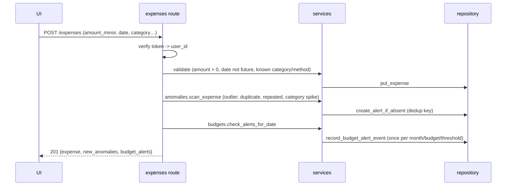
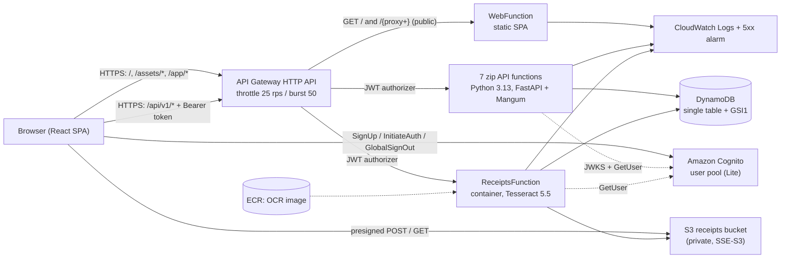

# FinSight — Technical Documentation

**FinSight — Cloud-Based Personal Finance Intelligence & Expense Analytics Platform**
Developed by Aakar Gupta · Vellore Institute of Technology, Chennai.

This is the detailed technical reference. Start with the [README](../README.md) for an overview, screenshots and quick start.
Facts in this document were checked against the repository and the live AWS stack on 2026-10-16. Account IDs appear only masked (`9672****3724`).

## Contents

1. [Project overview](#1-project-overview)
2. [Objectives and scope](#2-objectives-and-scope)
3. [Features](#3-features)
4. [Technology stack](#4-technology-stack)
5. [Application architecture](#5-application-architecture)
6. [Actual AWS architecture](#6-actual-aws-architecture)
7. [Local development](#7-local-development)
8. [Environment configuration](#8-environment-configuration)
9. [Authentication and authorization](#9-authentication-and-authorization)
10. [API reference](#10-api-reference)
11. [Database and data model](#11-database-and-data-model)
12. [Receipt storage and OCR](#12-receipt-storage-and-ocr)
13. [Testing](#13-testing)
14. [AWS deployment](#14-aws-deployment)
15. [Monitoring](#15-monitoring)
16. [Security](#16-security)
17. [Cost](#17-cost)
18. [Troubleshooting](#18-troubleshooting)
19. [Known limitations](#19-known-limitations)
20. [Future improvements](#20-future-improvements)
21. [Source code and asset map](#21-source-code-and-asset-map)
- [Appendix A. User interface design system](#appendix-a-user-interface-design-system)
- [Appendix B. Project history](#appendix-b-project-history)

---

## 1. Project overview

FinSight is a web application for recording expenses, managing monthly budgets and savings goals, and getting
**evidence-based** financial insights. Every figure it shows is calculated from the user's own records with transparent,
deterministic rules, and every automated result (insight, anomaly, OCR extraction) can be traced to its calculation and
reviewed by the user. No paid AI service is used at runtime.

The same codebase runs in two configurations:

- **Local:** Vite + FastAPI (Uvicorn) + SQLite + local receipt folder + local email/password authentication.
- **AWS (deployed, ap-south-1):** API Gateway HTTP API + Lambda (FastAPI through Mangum) + DynamoDB + private S3 + Amazon
  Cognito + CloudWatch, defined in one AWS SAM template. Live URL: <https://zkht2b4ib3.execute-api.ap-south-1.amazonaws.com>.

## 2. Objectives and scope

| # | Objective | Status |
|---|---|---|
| O1 | Record, edit, delete, search, filter, sort, paginate and export expenses with exact money arithmetic (integer paise) | Implemented, tested locally and live |
| O2 | Overall and category budgets with utilization, thresholds (default 75/90/100 %, one alert per threshold per month), projections and history | Implemented, tested |
| O3 | Dashboard and analytics computed only from the user's data, with like-for-like period comparison | Implemented, tested |
| O4 | Insights labelled fact / estimate / projection / recommendation / data gap, each with its evidence | Implemented, tested |
| O5 | Robust anomaly detection with a review workflow that never modifies transactions | Implemented, tested |
| O6 | Receipt OCR (Tesseract) with mandatory human confirmation | Implemented; tested locally and in the Lambda container |
| O7 | What-If simulation without side effects | Implemented, tested |
| O8 | Rule-based finance assistant over the user's own data | Implemented, tested (incl. data isolation) |
| O9 | Savings goals with contributions, required monthly saving and status | Implemented, tested |
| O10 | Authentication on every private endpoint and strict per-user isolation | Implemented; tested locally and live (401/404 checks) |
| O11 | Cost-conscious serverless AWS deployment as infrastructure as code, verified live | Deployed 2026-10-16; 64/64 live API checks, 27/27 browser checks |

**In scope:** responsive SPA with dark (default) and light themes; local auth and Amazon Cognito; expenses, categories,
payment methods, budgets, goals; dashboard and analytics; insights, anomalies, receipt OCR, What-If simulator, assistant;
private receipt storage; labelled, removable demo data; REST API; SQLite and DynamoDB repositories; AWS SAM template.

**Not supported (by design — do not present as features):** income tracking and savings rate, bank connections, cards,
investments, multi-currency conversion, professional financial advice, fraud determination.

## 3. Features

### 3.1 Verified feature matrix

| Feature | UI | API | Persisted | Invalid input | Isolation | Evidence |
|---|---|---|---|---|---|---|
| Registration / login / logout | ✓ | Cognito | Cognito | wrong password rejected | token `sub` | AUTH-01..07, UI-03/17/18 |
| Profile / settings / About | ✓ | `/me`, `/preferences` | DynamoDB | 422 on unknown fields | ✓ | PRF-01, UI-12, UI-22..27 |
| Expenses CRUD, search, filter, sort | ✓ | `/expenses` | DynamoDB | 422 with field details | ✓ (404 cross-user) | EXP-01..08, ISO-01, UI-05/06 |
| Budgets and thresholds | ✓ | `/budgets` | DynamoDB | 409 duplicate | ✓ | BUD-01..04, UI-07 |
| Dashboard / analytics | ✓ | `/dashboard`, `/analytics` | computed | — | ✓ | ANA-01/02 |
| Insights engine | ✓ | `/insights` | computed | — | ✓ | ANA-03 |
| Anomaly detection | ✓ | `/anomalies`, `/scan` | DynamoDB | — | ✓ | ANA-04/05 |
| Receipt OCR + review | ✓ | `/receipts/*` | S3 + DynamoDB | type, size, PDF → 422 | ✓ (404, unsigned 403) | RCT-01..10, UI-08/09 |
| What-If simulator | ✓ | `/simulations` | — | 422 | ✓ | SIM-01 |
| Savings goals | ✓ | `/goals` | DynamoDB | — | ✓ (404) | GOL-01/02, UI-11 |
| Finance assistant (rule-based) | ✓ | `/assistant/query` | — | ≤ 500 chars | ✓ | AST-01, UI-10 |
| Themes / responsive / animations | ✓ | — | localStorage | — | — | UI-14..16, `04_animations/` |

Evidence IDs refer to the live tests in [AWS_LIVE_TEST_RESULTS.md](AWS_LIVE_TEST_RESULTS.md). The landing page also shows
a **“Created by Aakar Gupta”** credit and an **About the author** dialog (information button in the header, and a row in
Settings); the dialog states that CloudFront is planned, not deployed (`frontend/src/components/AboutAuthor.tsx`).

### 3.2 Feature summary

| Area | What it does |
|---|---|
| Expenses | Create / view / edit / delete; search; filter by date range, category, payment method, amount; sort; paginate; totals; CSV export; notes, merchant, receipt attachment |
| Budgets | Overall and per-category monthly budgets; utilization; remaining; projected month-end spend; configurable thresholds (default 75/90/100%) alerted once each; budget versions keep history accurate; 6-month history |
| Dashboard & analytics | Month summary with like-for-like previous-month comparison, daily trend, category breakdown, 6-month stacked history, recent transactions, insights, anomalies, goal progress; analytics page with date presets and custom ranges |
| Intelligence engine | Month-over-month and category changes, category share / concentration, averages, budget-overrun projections, recurring-payment detection, goal pace, recommendations. Each insight is labelled **fact / estimate / projection / recommendation / data gap** and includes period, calculation, values and supporting transactions |
| Anomaly detection | Median + MAD robust z-scores per category, conservative overall comparison for thin history, duplicates, repeated same-day charges, category spikes. Review actions: reviewed / legitimate / dismiss / reopen / correct transaction. Configurable sensitivity |
| Receipt scanner | Upload (type, size and content validated) → Tesseract OCR with preprocessing → parser extracts merchant, date, total, tax, currency, line items with confidence → user reviews and edits → saved as an expense with the receipt attached |
| What-If simulator | Up to 4 scenarios, each with per-category % / fixed / target changes; baseline from last month, 3-month average or this month's projection; monthly and annual savings, budget impact, goal impact; "how much must I save" calculator. Nothing is written to real records |
| Savings goals | Target, saved amount, target date, progress, required monthly contribution, recent pace, status (on track / behind / overdue / completed), contribution and withdrawal history, archive |
| Assistant | Local intent recognition, entity extraction and date resolution; answers ~12 kinds of questions with deterministic calculations; asks for clarification when a period or goal is ambiguous |
| Account | Local email/password auth (scrypt + JWT) or Amazon Cognito; profile; currency, timezone, thresholds, sensitivity, custom categories, theme; demo data load/clear; delete all data; About the author |

### 3.3 How the analytical features work

#### Personal Finance Intelligence Engine (`services/insights.py`)

Rules run over the user's last seven months of transactions, budgets and goals:

- **Month over month** — for the current, incomplete month the comparison uses the same day range of the previous month (e.g. 1–15 Oct vs 1–15 Sep) so partial months are not compared with full ones.
- **Category changes** — reported when the change is ≥ 20% *and* material (≥ 5% of the previous period's total); new categories flagged.
- **Share and concentration** — top category share; warning when ≥ 50% with enough transactions.
- **Averages** — daily average (estimate) and average monthly spend over prior months with records (needs ≥ 2 months).
- **Projections** — month-end spend = spent ÷ days elapsed × days in month (only after ≥ 5 days), compared with overall and category budgets; exceeded budgets are reported as facts, possible overruns as projections, plus a daily allowance recommendation.
- **Recurring payments** — groups by merchant/category, amounts within 15% of the median, weekly or monthly intervals; detects new series and links them to category increases (e.g. a new subscription).
- **Savings goals** — required monthly contribution vs. recent 90-day contribution pace.
- **Recommendation** — for the largest discretionary increase, the saving from a 15% reduction of its typical month.

Each insight is labelled **fact, estimate, projection, recommendation or data gap**, and carries its period, formula, values and supporting transactions ("Why am I seeing this?"). When data is missing the engine says so rather than producing a claim.

#### Anomaly detection (`services/anomalies.py`)

| Signal | Method |
|---|---|
| Unusual amount for the category | Needs ≥ 5 prior transactions in the category. Modified z-score 0.6745·(x − median)/MAD ≥ 3.5 **and** amount ≥ 2.5× median (balanced). When MAD = 0 (identical amounts, e.g. subscriptions) only the ratio test applies. Repeated large transactions in 30 days raise severity |
| Large overall (thin category history) | Needs ≥ 10 transactions overall; amount ≥ max(5× overall median, 1.5× 95th percentile); skipped if a similar amount already exists in the category (prevents flagging rent); low severity |
| Possible duplicate | Same amount and merchant/description within 1 day; only the later entry is flagged |
| Repeated similar | 3+ transactions at the same merchant on one day |
| Category spike | Month total ≥ 1.75× the average of prior months (≥ 2 months with spending) |

Sensitivity presets (conservative / balanced / sensitive) adjust thresholds. Alerts include reason, comparison values, severity, detection time and review status; users can mark reviewed, confirm legitimate, dismiss, reopen or correct the transaction. Detection never changes transactions; dedup keys ensure rescans don't recreate reviewed alerts; editing a transaction re-evaluates its alerts and the month's category spikes.

#### Smart receipt scanner (`services/receipts/`)

Validation (magic bytes, type match, decode, size and pixel limits) → preprocessing (EXIF rotation, grayscale, scaling to OCR-friendly width, autocontrast, sharpen) → Tesseract (`--psm 4`) with per-line confidence → a separate parser:

- **Total**: keyword priority (grand total > net/amount payable > total > amount), excluding subtotal, tax totals, item counts, change, savings; picks the amount on the line or the next line; cross-checked against subtotal + tax or the sum of line items.
- **Date**: ISO, day-first numeric (default for INR receipts, with an ambiguity warning), month-name formats; future dates ignored.
- **Merchant**: first meaningful header line, skipping invoice/GSTIN/phone lines.
- **Tax**: CGST/SGST/IGST/VAT/tax lines (summed) or an explicit total-tax line.
- **Currency, line items, suggested category** via keyword rules.
- **Amounts**: handles Indian and European grouping, `/-` suffixes, common OCR digit confusions, and ignores dates, times, phone numbers and percentages.

Every field has a confidence score; unknown fields are left blank and listed as warnings. The user edits and confirms before an expense is created. Local storage keeps files in a private folder; AWS uses a private S3 bucket with presigned POST uploads and short-lived presigned GETs.

#### What-If simulator (`services/simulator.py`)

Baseline per category from last month, the average of the last 3 months with records, or this month's projection. Adjustments: reduce by %, reduce by amount (capped at current spend with a warning), or set a target amount. Output per scenario: current, new, monthly and annual savings (annual = monthly × 12, stated explicitly), budget impact, goal impact (months to reach the goal assuming savings are contributed) and a written explanation. Up to four scenarios are compared; the UI recalculates automatically after a 300 ms pause. A separate calculator gives the monthly saving needed for a goal or target. Nothing is persisted.

#### Conversational finance assistant (`services/assistant/`)

Pipeline: normalization → date resolution (today, yesterday, this/last week/month/year, last N days/months, named months with year inference, "between X and Y", "since X", "on X"; vague words like "recently" trigger a clarifying question) → entities (categories with synonyms such as "transport", "eating out", "Netflix"; merchants from the user's own records; percentages; amounts; goal names) → regex-scored intent detection over 14 intents → a handler that computes the answer with repository calls scoped to the authenticated user → a response with text, structured data (transactions, breakdowns, comparisons), the resolved period, suggestions and a not-financial-advice disclaimer. It never executes user text, and unsupported questions (income, investments, etc.) get an explanation of what it can answer.

### 3.4 Using each feature

- **Dashboard** — pick a month with the arrows. Click a category bar to open its transactions.
- **Transactions** — search box, *Filters* (dates, category, payment method, amount), sortable column headers, page size, *Export CSV*. Click a row for details, receipt image, edit or delete (with confirmation).
- **Add/edit expense** — amounts accept up to 2 decimals and are stored exactly; future dates are rejected.
- **Budgets** — *Set monthly budget* / *Category budget*; editing applies from this month (earlier months keep their budget). Thresholds are configured in Settings.
- **Analytics** — choose a preset range or *Custom*; *Show table* gives an accessible data view.
- **Insights** — filter by type; *Why am I seeing this?* shows the period, formula, values and transactions behind an insight.
- **Anomaly alerts** — review each flagged transaction: *Mark reviewed*, *It's legitimate*, *Dismiss*, *Reopen* or *Correct transaction*. *Re-scan* checks the last 180 days.
- **Receipt scanner** — drop or choose a JPEG/PNG/WebP (≤ 5 MB), *Scan receipt*, check each extracted field (confidence shown), edit, *Save expense*.
- **What-If simulator** — edit scenarios on the left; results update automatically. Optionally apply savings to a goal; use *How much do I need to save?* for a target.
- **Savings goals** — create goals, add contributions or withdrawals, view history, archive.
- **Assistant** — click a suggested question or type your own, e.g. "How much did I spend on transport in September?".
- **Profile / Settings** — name, password (local mode), currency, timezone, thresholds, anomaly sensitivity, theme, custom categories, demo data, delete all data.

## 4. Technology stack

Versions are the ranges declared in `frontend/package.json` and `backend/requirements*.txt` (resolved versions are in the lock file / virtualenv).

| Layer | Technology | Purpose |
|---|---|---|
| Frontend | React ^19.3, TypeScript ^7.0, Vite ^8.3, React Router ^8.4 | SPA, typed components, fast builds |
| Styling | Tailwind CSS ^4.3 with design tokens; Inter Variable (self-hosted) | Dark/light themes from one token set |
| Charts / UI | Recharts ^3.10, Radix Dialog, Sonner toasts, Lucide icons | Accessible charts, dialogs and notifications |
| Forms | React Hook Form ^7.90 + Zod ^4.6 | Client-side validation mirroring server rules |
| Backend | Python (3.14 locally, 3.13 on Lambda), FastAPI ≥0.115, Pydantic v2 | Typed API, validation, error handling |
| Lambda adapter | Mangum ≥0.19 | Runs the same FastAPI app on API Gateway events |
| Data | SQLite (local, WAL) · Amazon DynamoDB (AWS) | One `Repository` interface, two implementations |
| OCR | Tesseract 5 (5.4 locally, 5.5 in the Lambda image) via pytesseract; Pillow ≥11 | Open-source OCR, no per-page fee |
| Auth | scrypt + PyJWT (HS256) locally; Amazon Cognito (RS256, JWKS) in AWS | Local accounts / managed identity |
| IaC | AWS SAM / CloudFormation (`infra/template.yaml`) | All AWS resources in one template |
| Tests | pytest ≥8.3, httpx, moto ≥5 (AWS mocks); Vitest ^3.2 + Testing Library | Unit, API, security and AWS-path tests |

## 5. Application architecture

### 5.1 Local and AWS configurations

| | Local | AWS (deployed 2026-10-16) |
|---|---|---|
| Frontend hosting | Vite dev server (`npm run dev`) | `WebFunction` (static-file Lambda) on the HTTP API, same origin as the API (`FrontendHosting=apigateway`). S3 + CloudFront (OAC) is defined in the template but not deployed |
| API entry | FastAPI on Uvicorn; Vite proxies `/api` | API Gateway HTTP API → Lambda (Mangum) |
| Authentication | scrypt hashes, HS256 JWT issued by the backend | Cognito user pool; access tokens checked by the API Gateway JWT authorizer **and** re-verified by the backend (JWKS + `GetUser` revocation check) |
| Database | SQLite `backend/data/finance.db` | DynamoDB single table, on-demand |
| Receipt files | `backend/data/receipts/<user>/<id>.<ext>` (never served statically) | Private S3 bucket; presigned POST upload, 2-minute presigned GET |
| OCR | Tesseract installed on the machine | Tesseract inside the receipts Lambda container image |
| Logs | stdout | CloudWatch Logs (14-day retention) |

Switching is configuration only (`DATA_BACKEND`, `AUTH_MODE`, `RECEIPT_STORAGE`, …; see [§8](#8-environment-configuration)).

### 5.2 Backend layers

```
api/routes/*        HTTP concerns: parsing, auth context, status codes, serialization
      │  depends on
services/*          Business logic (pure functions where possible; no HTTP, no SQL/DynamoDB)
      │  depends on
repositories/base   Abstract Repository interface
      ├── sqlite_repo.py     (local)
      └── dynamodb_repo.py   (AWS)
domain/*            Records (Pydantic), money (integer minor units), dates, categories
```

- **Dependency injection**: `create_app()` builds the repository and receipt storage from settings and stores them on `app.state`; routes receive them through FastAPI dependencies (`api/deps.py`). Tests inject a temporary SQLite repository or a moto-backed DynamoDB repository.
- **Identity**: `get_current_user` validates the bearer token and returns the user id. Every service call receives this id; no endpoint accepts a user id from the client (request models use `extra="forbid"`).
- **Money**: all amounts are integers in minor units (paise). Ratios use `Decimal`; rounding is half-up and only for presentation.
- **Time**: transaction dates are calendar dates as entered; "today"/"this month" use the user's timezone preference; timestamps are stored in UTC and shown in the user's timezone.

#### Route groups and Lambda functions

`create_app(groups=[...])` mounts only the requested routers. Each Lambda handler (`app/handlers/<group>.py`) builds the app for its group once per warm container. This gives per-function IAM permissions (only the receipts function can read/write receipt objects) while keeping one codebase and no duplicated logic.

| Group | Paths | Function |
|---|---|---|
| expenses | `/expenses`, `/expenses/{id}` | ExpensesFunction |
| budgets | `/budgets`, `/budgets/history`, `/budgets/{id}` | BudgetsFunction |
| analytics | `/dashboard`, `/analytics`, `/insights` | AnalyticsFunction |
| anomalies | `/anomalies`, `/anomalies/scan`, `/anomalies/{id}/review` | AnomaliesFunction |
| receipts | `/receipts/**` | ReceiptsFunction (container image) |
| planning | `/goals/**`, `/simulations/**` | PlanningFunction |
| assistant | `/assistant/query` | AssistantFunction |
| account | `/health`, `/config`, `/me`, `/reference`, `/preferences`, `/categories/**`, `/demo-data`, `/account/delete-data` | AccountFunction |
| auth | `/auth/register`, `/auth/login`, `/auth/change-password` | local mode only (Cognito replaces it in AWS) |

### 5.3 Key flows

#### Creating an expense



Post-save checks are wrapped so a failure there never loses the saved transaction.

#### Receipt processing

1. **Upload** — local: `POST /receipts` (multipart, backend-mediated). AWS: `POST /receipts/upload-url` returns a presigned POST whose policy fixes the key, content type, server-side encryption and a 1 B–5 MB size range; the browser posts directly to the private bucket.
2. **Process** — `POST /receipts/{id}/process` loads the bytes, re-validates them (magic bytes, decodability, dimensions — presigned uploads bypass the API), preprocesses (EXIF rotation, grayscale, scaling, autocontrast, sharpen), runs Tesseract (`--psm 4`), groups words into lines with mean confidence, then the **parser** extracts fields.
3. **Review** — the UI shows every field with a confidence badge, warnings, line items and raw text, pre-filling an editable form. Missing fields stay empty.
4. **Confirm** — `POST /receipts/{id}/confirm` creates the expense linked to the receipt.

#### Intelligence, anomalies, simulator, assistant

All four are implemented as pure functions over lists of expenses (plus budgets/goals) and are unit-tested without HTTP:

- `services/insights.py` — rule set described in the report; every insight carries `kind`, `severity`, `evidence{period, calculation, values, transactions}`.
- `services/anomalies.py` — robust statistics (median, MAD, modified z-score ≥ 3.5 *and* ≥ 2.5× median by default), small-sample fallbacks, duplicates, spikes; persistence is separate (`scan_expense`, `scan_all`).
- `services/simulator.py` — baselines and adjustments; never writes.
- `services/assistant/` — `nlu.py` (normalization, date resolution, entities, intents) and `engine.py` (one handler per intent, all calculations via the repository scoped to the authenticated user).

### 5.4 Frontend

- **Routing** (`App.tsx`): public landing, login, register; authenticated `/app/*` routes are lazily loaded and wrapped by `RequireAuth` (a UX guard only — the API enforces authorization).
- **API client** (`lib/api.ts`): one `request()` function adds the bearer token, builds query strings, converts error envelopes to `ApiError`, and signs out on 401. The base URL comes from `VITE_API_BASE_URL` (empty for the same-origin AWS deployment and for local development). Failed requests show error states with *Try again* — no fallback data.
- **Auth** (`lib/auth.tsx`): reads `/config` to choose local auth or Cognito (`lib/cognito.ts` calls the Cognito IdP API directly; tokens refresh automatically). Tokens are kept in memory and `sessionStorage`.
- **App data** (`lib/appData.tsx`): user, preferences, categories, payment methods, currency and timezone-aware "today".
- **Design system**: CSS custom properties for light/dark themes mapped into Tailwind; shared primitives (`components/ui`); charts use a validated categorical palette with a fixed category→color mapping, thin bars, one y-axis, tooltips and a table view.

### 5.5 Design decisions

| Decision | Rationale |
|---|---|
| Integer minor units for money | Exact arithmetic; no float drift |
| Single DynamoDB table keyed by user | All access patterns are per-user; partition key isolates users; one table is cheaper and simpler than eight |
| Filtering/sorting in the service layer | Identical behaviour for SQLite and DynamoDB; personal datasets are small; avoids DynamoDB Scan |
| Insights computed on demand (not stored) | Always consistent with current transactions; no stale cache |
| Budget versions (`effective_from`/`effective_to`) | Editing a budget doesn't rewrite history |
| Threshold events stored with a uniqueness key | Alerts fire once per month/budget/threshold; conditional write in DynamoDB |
| Anomaly dedup keys + review status | Re-scans never recreate alerts the user already reviewed or dismissed |
| Lambda per route group, shared code | Least-privilege IAM per function without duplicating logic |
| Receipts Lambda as container image | Tesseract is a native binary not available in the managed Python runtime |
| HTTP API instead of REST API | Lower price, native JWT authorizer |
| Frontend served by a Lambda on the same HTTP API (`FrontendHosting=apigateway`) | CloudFront was refused for the new account; same origin means no browser CORS for API calls. CloudFront returns with one parameter change |
| Backend `GetUser` check after JWT verification | API Gateway JWT authorizers do not check revocation; makes sign-out effective within 15 s |
| Rule-based assistant | Deterministic, auditable, free; no data leaves the system |

### 5.6 Animations and transitions

#### Approach

- **No new dependency.** Motion is CSS-first (keyframes and utility classes in the "motion" section of
  `frontend/src/index.css`), plus a small hook module `frontend/src/lib/motion.ts` for the two things CSS cannot do:
  counting figures and deciding *when* Recharts should animate. Recharts' own animation engine draws the charts.
- **Tokens:** `--ease-out: cubic-bezier(0.16,1,0.3,1)` (entrances), `--ease-standard` (loops). Durations: 160–360 ms
  for UI, 650–750 ms for charts and number counts, 450 ms for simulator results.
- Existing identity is unchanged: same dark/emerald and light palettes, radii, spacing and components.

#### Components enhanced

| Area | Behaviour | Where |
|---|---|---|
| Page transitions | On every route change the page's top-level blocks (header, then each row) rise 8px and fade in with a 35 ms stagger (max 175 ms). Keyed by pathname, so it never replays on data refreshes. | `.page-enter > *` · `AppShell.tsx` |
| Sidebar | Emerald active indicator grows in beside the current page (`aria-current`). Icons nudge 1px on hover. Background/colour transitions. Keyboard focus ring kept. | `.nav-item` |
| Mobile navigation | Drawer slides in **and out** (stays mounted 170 ms on close). Overlay fades. Escape and overlay click close it. | `AppShell.tsx` |
| Dashboard | KPI figures, remaining budget and trend total count up from their previous value (`AnimatedNumber`). Cards rise in. Donut, area and bar charts draw in. Progress bars grow from empty. While the month changes, the previous figures stay on screen dimmed (`fs-refreshing`) instead of flashing to skeletons. | `Dashboard.tsx`, `primitives.tsx`, charts |
| Charts | Animate on entry and when their values actually change (`useChartAnimation` + `dataSignature`), never on unrelated re-renders. Values and axes are never distorted; tooltips are unchanged. | `Trend.tsx`, `Donut.tsx`, `Charts.tsx` |
| Progress (budgets, goals, category bars) | Width transitions over 700 ms from 0 on mount, then glide between values. | `Progress`, `GrowBar` |
| Forms | Focus ring/border transitions (existing). Validation messages slide in (`fs-field-msg`). Buttons press-scale to 0.97, show a spinner and `aria-busy` while submitting. | `primitives.tsx` |
| Expense management | Filter panel slides open. The result list cross-fades once per filter/sort/page change (keyed by the visible ids, one element, no per-row animation). The table dims while reloading. Empty states rise in. | `Transactions.tsx` |
| Savings goals | Saved amount counts up after a contribution. The status badge pops once when the status changes (e.g. *Completed*). No confetti. | `Goals.tsx` |
| Receipt scanner | Preview fades in. A scan line sweeps the image while working. Step list (Upload → Read text → Review) with a done tick, an indeterminate bar and a live "Still working · Ns" timer. The review panel rises in; "Saved" pops. "Start over" hidden while OCR runs. | `Receipts.tsx` |
| What-If simulator | Savings figures count from old to new (450 ms) and the comparison dims while recalculating. Inputs are never blocked. | `Simulator.tsx` |
| Finance assistant | Messages enter with a short rise/scale from the sender's side. "Calculating…" shows animated dots. | `Assistant.tsx` |
| Modals | Existing Radix enter/exit animations (fade + 6px rise + 0.98 scale), now with `both` fill on exit. Focus returns to the opener. | `dialog.tsx` |
| Theme switching | 260 ms colour cross-fade, applied only on an explicit switch (`theme-transition` class on `<html>`). The initial theme is still applied before first paint in `index.html`, so there is no flash of the wrong theme. The toggle icon rotates in. | `utils.ts`, `AppShell.tsx` |
| Notifications | Sonner toasts keep their built-in enter/exit. The alert-bell count badge pops when the count changes. | — |
| Insight cards | 1px hover lift on pointer devices. | `InsightCard.tsx` |

#### Accessibility

- `prefers-reduced-motion: reduce`: all animations and transitions shrink to 0.01 ms with no delays. Looping
  indicators become static but stay visible (status is also given in text). Count-ups return the final value
  immediately. Charts do not animate. The theme cross-fade is skipped.
- `AnimatedNumber` renders the final figure in an `sr-only` span and hides intermediate frames (`aria-hidden`), so
  screen readers never hear counting.
- Processing states use `role="status"` / `aria-live`. Busy regions set `aria-busy`.
- Focus-visible outlines are unchanged. Animations never block clicks or keyboard input (no waiting on `animationend`).

#### Performance

- Only `opacity` and `transform` are animated (compositor-friendly), plus `width` on thin progress bars.
- No animation libraries were added; `motion.ts` is under 1 KB gzipped.
- Charts animate only on entry and on real data changes. Lists animate one container, not each row.
- Hover lifts apply only on `(hover: hover)` devices.

#### Testing

- `src/lib/motion.test.ts`: 4 tests (signature stability; count-up under reduced motion; chart animation on
  entry, no replay on identical data, replay on new data; disabled under reduced motion). Frontend suite: **17 passed**.
- `npm run typecheck` and `npm run build` pass.
- Browser verification (headless Chrome via `docs/evidence/capture/local.mjs`): 36 captures across all routes,
  including mid-animation frames, with **0 console errors and 0 failed requests**. Frames are in `docs/evidence/04_animations/`
  (page transition, dashboard entrance, modal opening, form validation, receipt processing, assistant typing,
  theme switch, mobile drawer, sidebar hover/focus, settled budget and savings progress).

## 6. Actual AWS architecture

Source of truth: the live stack `finance-intelligence-prod` (ap-south-1), read with read-only AWS CLI calls
(`docs/evidence/07_aws_deployment/`), and `infra/template.yaml`. The planned design is the template default
(`FrontendHosting=cloudfront`); **the deployed stack differs in one place: there is no CloudFront distribution and no web
bucket.** Stack status on 2026-10-16: `UPDATE_COMPLETE` (created 13:29 IST, three code-only updates), 63 resources.

### 6.1 Request flow (as deployed)



- The SPA and the API share **one origin** (`https://zkht2b4ib3.execute-api.ap-south-1.amazonaws.com`). The frontend is built with
  an empty `VITE_API_BASE_URL`, so the browser calls `/api/v1/*` on the same host and **no cross-origin requests to the API occur**.
  The only cross-origin calls go to Cognito (public IdP API) and to S3 with presigned URLs.
- API Gateway picks the most specific route, so the `/api/v1/*` routes always beat the greedy `GET /{proxy+}` web route.
  The web function returns a JSON 404 for any unmatched `/api/*` path instead of the SPA.

### 6.2 Hosting

| Item | Deployed | Planned (template default) |
|---|---|---|
| Static SPA | `WebFunction` (`infra/web/handler.py`, stdlib). Hashed `/assets/*` → `Cache-Control: public,max-age=31536000,immutable`; other paths → `no-cache`; unknown extension-less paths → `index.html`; security headers HSTS, nosniff, X-Frame-Options, Referrer-Policy | Private S3 bucket + CloudFront (OAC, PriceClass_200, managed security-headers policy, SPA error fallback) |
| Why | CloudFront refused: *"Your account must be verified before you can add new CloudFront resources"* (2 attempts, `docs/evidence/07_aws_deployment/sam_deploy_attempt2_cloudfront_blocked.txt`) | Enable after AWS Support verifies the account; switch `FrontendHosting=cloudfront` and redeploy |
| Trade-off | No CDN edge caching; every asset request is a Lambda invocation (warm ≈ 15–90 ms); same TLS/HTTPS; simpler (no CORS) | Edge caching, lower latency outside India, fewer Lambda invocations |

### 6.3 Data persistence (DynamoDB single table)

`PK = USER#<sub>`, `SK = <TYPE>#<id>`, and `GSI1` covers expense date ranges. The table is on-demand, SSE is enabled, PITR is off (cost), and **DeletionPolicy is Retain**. Every query is scoped by the caller's partition key; no Scan is used anywhere. Cross-user requests return 404 (live test ISO-01).

### 6.4 IAM and security boundaries

| Role | Permissions |
|---|---|
| 7 API function roles | `AWSLambdaBasicExecutionRole` (logs) + shared `TableAccessPolicy`: GetItem/PutItem/UpdateItem/DeleteItem/Query/BatchWriteItem/ConditionCheckItem/DescribeTable on **one table and its indexes** |
| AccountFunction | + `s3:DeleteObject` on `receipts-bucket/*` (account data deletion) |
| ReceiptsFunction | + `s3:GetObject/PutObject/DeleteObject` on `receipts-bucket/*` |
| WebFunction | logs only |

There are no wildcard actions, no `iam:*` and no access to other buckets or tables. `GetUser` needs no IAM permission (it is authorized by the access token).

### 6.5 Infrastructure management

AWS SAM / CloudFormation:

- `finance-intelligence-prod`: 63 resources.
- `finance-intelligence-prod-e62c8f15-CompanionStack`: the SAM-managed ECR repository.
- `aws-sam-cli-managed-default`: the SAM artifact bucket.

Changes are previewed as changesets. Every update so far has been code-only, with Replacement False.

### 6.6 Resources defined in the template

`infra/template.yaml` (AWS SAM) defines:

| Resource | Type | Notes |
|---|---|---|
| `FinanceTable` | DynamoDB table | On-demand, SSE, `PK`/`SK` + `GSI1`; **Retain** on stack deletion |
| `ReceiptBucket` | S3 bucket | Private, all public access blocked, SSE-S3, TLS-only policy, CORS for presigned POST from the web origin only, abort incomplete uploads after 1 day; **Retain** |
| `FrontendBucket` + `FrontendOAC` + `FrontendDistribution` (**only when `FrontendHosting=cloudfront`; not deployed**) | S3 + CloudFront | Private bucket readable only by this distribution (Origin Access Control), HTTPS redirect, managed caching and security-headers policies, SPA fallback to `index.html` |
| `UserPool` + `UserPoolClient` | Cognito | Lite tier, email as username, email verification via Cognito's default sender, public client (no secret) with `USER_PASSWORD_AUTH` + refresh, 60-min access tokens |
| `HttpApi` | API Gateway HTTP API | Cognito JWT authorizer by default (only `/health`, `/config` public), CORS limited to the web origin (+ optional extra origin), throttling 25 rps / burst 50 |
| 8 API Lambda functions + `WebFunction` | Lambda | 7 zip functions (Python 3.13) + `ReceiptsFunction` container image with Tesseract; `WebFunction` (256 MB, stdlib) serves the SPA when `FrontendHosting=apigateway` |
| `TableAccessPolicy` | IAM managed policy | Get/Put/Update/Delete/Query/BatchWrite/ConditionCheck/DescribeTable on the one table and its index — no Scan, no other tables |
| 9 log groups | CloudWatch Logs | 14-day retention |
| `ApiServerErrorsAlarm` | CloudWatch alarm | ≥ 5 API 5xx in 5 minutes (no notification target attached) |

Outputs: `ApiUrl`, `WebUrl`, `FrontendHosting`, `ReceiptBucketName`, `TableName`, `UserPoolId`, `UserPoolClientId` (plus `FrontendBucketName` and `DistributionId` in CloudFront mode).

## 7. Local development

Prerequisites, installation and run commands are in the README ([Local setup](../README.md#local-setup)). Summary:

```powershell
# backend (Windows; use source .venv/bin/activate on macOS/Linux)
cd backend
python -m venv .venv
.\.venv\Scripts\activate
pip install -r requirements-dev.txt
uvicorn app.main:create_app --factory --port 8000 --reload

# frontend (second terminal)
cd frontend
npm install
npm run dev            # http://localhost:5173 (proxies /api to :8000)
```

- **No configuration is needed locally:** SQLite, local auth, local receipt storage and demo data are the defaults. The local
  JWT signing secret is generated on first start in the git-ignored `backend/data/.jwt_secret`.
- **Reset local data:** stop the backend and delete `backend/data/` (database, receipts, local secret).
- **Other port:** run the backend on another port and start Vite with `API_PROXY_TARGET=http://127.0.0.1:<port>`.
- **Interactive API docs:** http://localhost:8000/api/docs (disabled when `APP_ENV=production`).
- **Brand assets:** the mark is `frontend/public/favicon.svg` and `frontend/src/components/brand/Brand.tsx`; regenerate the
  PNG/ICO fallbacks with `python frontend/scripts/generate_icons.py` (needs Pillow, available in the backend virtualenv).
- **Claude preview configurations:** `.claude/launch.json` defines `backend` (port 8000) and `frontend` (port 5173).

## 8. Environment configuration

All backend settings are environment variables read in `backend/app/config.py`; `.env.example` lists them with placeholders
(copy the backend section to `backend/.env`, the frontend section to `frontend/.env.local`). AWS credentials are never
configured in these files: Lambda uses its IAM role.

| Variable | Default | Meaning |
|---|---|---|
| `APP_ENV` | `development` | `production` disables API docs, requires secrets and rejects wildcard CORS |
| `DATA_BACKEND` | `sqlite` | `sqlite` or `dynamodb` |
| `SQLITE_PATH` | `backend/data/finance.db` | local database file |
| `AUTH_MODE` | `local` | `local` (email/password + JWT) or `cognito` |
| `JWT_SECRET` / `JWT_TTL_MINUTES` | auto-generated / `120` | local-mode token signing; required in production with local auth |
| `COGNITO_USER_POOL_ID` / `COGNITO_APP_CLIENT_ID` | — | Cognito mode (public identifiers, also served by `/config`) |
| `COGNITO_REVOCATION_CHECK` / `TOKEN_CHECK_CACHE_SECONDS` | `true` / `15` | backend `GetUser` revocation check and its per-token cache |
| `CORS_ORIGINS` | `http://localhost:5173` | allowed browser origins (never `*` in production) |
| `ALLOW_DEMO_DATA` | `true` outside production | enables the synthetic demo-data endpoints |
| `RECEIPT_STORAGE` / `RECEIPT_DIR` / `RECEIPT_BUCKET` | `local` / `backend/data/receipts` / — | receipt storage backend |
| `MAX_RECEIPT_BYTES` | `5242880` | upload size limit (5 MB) |
| `TESSERACT_CMD` | auto-detected | path to `tesseract` if not on PATH |
| `DYNAMODB_TABLE` / `AWS_REGION` | `finance-app` / `ap-south-1` | AWS data settings (set by the template in Lambda) |
| `LOG_LEVEL` | `INFO` | logging level |
| `VITE_API_BASE_URL` (frontend) | empty | empty locally (Vite proxy) and in the same-origin AWS build |

### 8.1 Local versus AWS values

| Setting | Local | AWS (set by template) |
|---|---|---|
| `APP_ENV` | development | production (docs endpoints off, secrets required, wildcard CORS rejected) |
| `DATA_BACKEND` | sqlite | dynamodb |
| `AUTH_MODE` | local | cognito |
| `RECEIPT_STORAGE` | local | s3 |
| `CORS_ORIGINS` | http://localhost:5173 | CloudFront URL in CloudFront mode; a non-resolvable placeholder (`https://same-origin.invalid`) in API Gateway mode, where the SPA and API share one origin (+ optional `ExtraCorsOrigin`) |
| `ALLOW_DEMO_DATA` | true | false (parameter) |
| Frontend API URL | Vite proxy (`/api`) | empty (same origin; staged by `infra/prepare_build.py`) in API Gateway mode; `VITE_API_BASE_URL=<ApiUrl>` in CloudFront mode |
| Receipt upload | multipart to backend | presigned POST directly to S3 |
| AWS credentials | none needed | Lambda execution roles (never keys in code or env files) |

## 9. Authentication and authorization

### 9.1 Amazon Cognito (Lite tier)

1. The SPA reads the public pool id and client id from `GET /api/v1/config`.
2. Sign-up: `SignUp` → Cognito emails a code → `ConfirmSignUp`.
3. Sign-in: `InitiateAuth` `USER_PASSWORD_AUTH` (public client, no secret) returns ID, access and refresh tokens. Tokens are held in `sessionStorage`; access and ID tokens last 60 min, refresh tokens 7 days.
4. Sign-out: `GlobalSignOut`. Revocation is enabled on the client.

### 9.2 API authorization (two layers)

1. **API Gateway JWT authorizer** (`CognitoJwt`): checks signature, issuer `https://cognito-idp.ap-south-1.amazonaws.com/ap-south-1_qp3zLx5jI`, audience (app client) and expiry. Missing or invalid tokens get 401 before any Lambda runs. `/health` and `/config` (and the web routes) are public.
2. **Backend** (`backend/app/auth/tokens.py`):
   - re-verifies the RS256 signature against the pool JWKS, plus issuer, expiry, `token_use=access` and `client_id`;
   - **checks revocation with Cognito `GetUser`**, so that sign-out invalidates the access token (cached 15 s per token per warm container; fail-open on throttling, with a log line);
   - takes the user id **only** from the token `sub`, never from the body, query or path.

### 9.3 Local mode

`POST /auth/register` hashes the password with scrypt (N = 2¹⁴, r = 8, p = 1, 16-byte salt) and `POST /auth/login` issues an
HS256 JWT (required claims `sub`, `exp`, `iat`, `iss`; algorithm pinned) signed with a ≥ 48-byte random secret. Five failed
logins per e-mail and IP within five minutes return 429. Tokens are kept in memory and `sessionStorage`, never in URLs or
`localStorage`. The frontend reads `/config` to choose local or Cognito mode (`frontend/src/lib/auth.tsx`, `lib/cognito.ts`).

## 10. API reference

Base path: `/api/v1`. Interactive OpenAPI docs are served locally at `http://localhost:8000/api/docs` (disabled when `APP_ENV=production`).

### Conventions

- **Authentication**: `Authorization: Bearer <access token>` on every endpoint except `/health`, `/config`, `/auth/register`, `/auth/login`. The user is always taken from the token.
- **Money**: integers in minor units, field names end in `_minor` (₹450.50 → `45050`).
- **Dates**: `YYYY-MM-DD`; months `YYYY-MM`; timestamps ISO 8601 UTC.
- **Unknown fields are rejected** (422) — e.g. sending `user_id` in a body.
- **Errors** use one envelope:

```json
{ "error": { "code": "validation_error", "message": "date: Date cannot be in the future.",
             "details": [{ "field": "date", "message": "Date cannot be in the future." }] } }
```

| Status | Codes |
|---|---|
| 401 | `unauthorized`, `token_expired`, `invalid_credentials` |
| 403 | `forbidden` |
| 404 | `not_found` (also returned for other users' records) |
| 409 | `conflict` |
| 422 | `validation_error`, `file_too_large`, `unsupported_file_type`, `type_mismatch`, `unreadable_image`, `ocr_failed`, `ocr_timeout` |
| 429 | `too_many_requests` |
| 503 | `ocr_unavailable` |
| 500 | `internal_error` (no internals exposed) |

### Meta

| Method | Path | Description |
|---|---|---|
| GET | `/health` | `{status, database, environment, data_backend}` |
| GET | `/config` | Public settings for the SPA: `auth_mode`, Cognito pool/client ids (public values), `demo_data_enabled`, `receipt_upload_mode` |

### Auth (local mode only)

| Method | Path | Body | Response |
|---|---|---|---|
| POST | `/auth/register` | `{name, email, password}` (≥ 8 chars, letter + number) | 201 `{access_token, expires_in, user}` · 409 if email exists |
| POST | `/auth/login` | `{email, password}` | `{access_token, …}` · 401 · 429 after 5 failures / 5 min |
| POST | `/auth/change-password` | `{current_password, new_password}` | `{message}` |

### Expenses

| Method | Path | Notes |
|---|---|---|
| GET | `/expenses` | Query: `start`, `end`, `category` (repeatable), `payment_method` (repeatable), `search`, `min_amount_minor`, `max_amount_minor`, `sort` (`date`,`amount`,`category`,`merchant`,`description`,`created_at`), `order` (`asc`/`desc`), `page`, `page_size` (≤ 100). Returns `{items, total_count, total_amount_minor, page, page_size, total_pages}` — totals cover all matches, not just the page |
| POST | `/expenses` | Body below. Returns `{expense, new_anomalies, budget_alerts}` |
| GET | `/expenses/{id}` | |
| PUT | `/expenses/{id}` | Full replacement, same body; re-runs detection |
| DELETE | `/expenses/{id}` | 204; removes alerts tied to the transaction |

```json
{ "amount_minor": 45050, "date": "2026-10-14", "category": "food", "description": "Dinner",
  "merchant": "Swiggy", "payment_method": "upi", "notes": null, "receipt_id": null }
```

Validation: amount 1 … 10¹³; date 2000-01-01 … today (user timezone); category from `/reference`; payment method `upi|debit_card|credit_card|cash|net_banking|wallet|other`; description 1–120 chars.

### Budgets

| Method | Path | Notes |
|---|---|---|
| GET | `/budgets?month=YYYY-MM` | `{overall, categories[], unbudgeted[], thresholds, new_alerts[], alert_events[], total_spent_minor}`; each row has `amount_minor, spent_minor, remaining_minor, utilization_pct, status (ok|warning|at_limit|exceeded), thresholds_crossed, projected_spend_minor, projected_overrun, daily_allowance_minor` |
| GET | `/budgets/history?months=6` | Per month: spent, overall budget in effect, utilization, within_budget, categories over budget |
| POST | `/budgets` | `{category: null|"food", amount_minor}`; 409 if one exists |
| PUT | `/budgets/{id}` | `{amount_minor}` — applies from the current month (new version if it already applied earlier); re-arms this month's alerts |
| DELETE | `/budgets/{id}` | Ends the budget from this month (kept for history) |

### Dashboard, analytics, insights

| Method | Path | Notes |
|---|---|---|
| GET | `/dashboard?month=YYYY-MM` | Summary (with like-for-like comparison), budget overview, categories, daily series, 6-month series, recent transactions, top insights, open anomalies, goals, upcoming targets — all from one dataset |
| GET | `/analytics?start&end` | Totals, averages, categories, payment methods, daily (≤ 120 days), monthly, top merchants; max range 3 years |
| GET | `/insights?month=YYYY-MM` | `{generated_for, coverage, recurring[], insights[]}`; insight: `{id, kind, severity, title, message, category, action, evidence{period, calculation, values, transactions}}` |

### Anomalies

| Method | Path | Notes |
|---|---|---|
| GET | `/anomalies?status=all|open|reviewed|legitimate|dismissed` | Items include `rule, severity, reason, comparison, detected_at, status, expense{…}`; plus `counts` |
| POST | `/anomalies/scan` | Re-scan last 180 days; `{scanned, findings, created}` |
| POST | `/anomalies/{id}/review` | `{action: reviewed|legitimate|dismissed|open, note?}` |

### Receipts

| Method | Path | Notes |
|---|---|---|
| GET | `/receipts/status` | `{ocr_available, upload_mode, max_bytes, accepted_types}` |
| GET | `/receipts` | Recent receipts (metadata + extracted fields) |
| POST | `/receipts` | multipart `file` (JPEG/PNG/WebP ≤ 5 MB) — direct upload |
| POST | `/receipts/upload-url` | `{content_type, size_bytes}` → `{receipt_id, upload: {url, fields}, expires_in}` (S3 mode) |
| POST | `/receipts/{id}/process` | Runs OCR + parsing; returns `extracted{merchant, date, total, tax, currency, subtotal, line_items, suggested_category, warnings, raw_text, ocr_confidence, total_minor, tax_minor, currency_mismatch}`; each field `{value, confidence 0–1, source}` |
| GET | `/receipts/{id}` | |
| GET | `/receipts/{id}/image` | Local: image bytes (`Cache-Control: private, no-store`). S3: `{url, expires_in: 120}` |
| POST | `/receipts/{id}/confirm` | Expense body (as POST /expenses) → creates the expense linked to the receipt |
| DELETE | `/receipts/{id}` | Deletes file and metadata; unlinks the expense |

### Goals and simulations

| Method | Path | Notes |
|---|---|---|
| GET | `/goals` | `{items[], summary}`; goal includes `remaining_minor, progress_pct, status, required_monthly_minor, months_left, recent_monthly_contribution_minor, projected_completion_date, contributions[]` |
| POST | `/goals` | `{name, target_minor, saved_minor?, target_date?}` (future date) |
| GET/PUT/DELETE | `/goals/{id}` | PUT: `{name?, target_minor?, target_date?, clear_target_date?, archived?}` |
| POST | `/goals/{id}/contributions` | `{amount_minor (negative = withdrawal), date?, note?}` |
| DELETE | `/goals/{id}/contributions/{cid}` | |
| POST | `/simulations` | `{baseline: avg_3_months|last_month|current_month_projection, goal_id?, scenarios: [{name, adjustments: [{category, mode: percent|amount|target, value}]}]}` (≤ 4 scenarios). Returns baseline and per-scenario rows, monthly/annual savings, budget and goal impact, explanation |
| POST | `/simulations/required-savings` | `{goal_id}` or `{target_minor, months}` → required monthly saving and share of baseline spending |

### Assistant

`POST /assistant/query` `{question}` (≤ 500 chars) →

```json
{ "answer": "You spent ₹1,993 on Transportation for September 2026, across 11 transaction(s).",
  "intent": "total_spent", "period": {"start": "2026-09-01", "end": "2026-09-30", "label": "September 2026"},
  "data": {"kind": "metrics", "total_minor": 199300, "count": 11},
  "suggestions": [], "needs_clarification": false,
  "disclaimer": "This is an automated summary of your records, not financial advice." }
```

Intents: `total_spent`, `transaction_count`, `average_spending`, `top_category`, `category_change`, `budget_remaining`, `budget_status`, `unusual_transactions`, `largest_transactions`, `list_transactions`, `simulate_saving`, `goal_requirement`, `help`, `unsupported`.

### Account

| Method | Path | Notes |
|---|---|---|
| GET | `/me` | User, preferences (with categories), `auth_mode`, `demo_data_enabled` |
| GET | `/reference` | Categories, payment methods, currencies |
| PUT | `/preferences` | `{display_name?, currency?, timezone?, budget_thresholds?, anomaly_sensitivity?}` |
| POST | `/categories` | `{name}` custom category |
| DELETE | `/categories/{id}` | Moves its expenses to `other`, removes its budget |
| POST / DELETE | `/demo-data` | Load / remove labelled synthetic data (403 when disabled) |
| POST | `/account/delete-data` | `{confirm: "DELETE", password}` — deletes all data (and the local account) |

## 11. Database and data model

All persistence goes through `app/repositories/base.py::Repository`. Services never issue SQL or DynamoDB calls. Two implementations share the same record models (`app/domain/models.py`) and pass the same API test suite.

### Entities

| Entity | Key fields | Notes |
|---|---|---|
| User | id, email, name, password_hash | Local auth only (Cognito stores users in AWS) |
| Preferences | user_id, currency, timezone, budget_thresholds, anomaly_sensitivity, custom_categories, display_name | One per user, created on first request |
| Expense | id, user_id, amount_minor, date, category, description, merchant, payment_method, notes, receipt_id, is_demo, created_at, updated_at | Amount in integer minor units |
| Budget | id, user_id, category (null = overall), amount_minor, effective_from, effective_to | Versioned by month |
| BudgetAlertEvent | user_id, month, budget_key, threshold, spent_minor, budget_minor | Unique per (user, month, budget, threshold) |
| Goal | id, user_id, name, target_minor, saved_minor, target_date, archived, contributions[] | Contributions embedded (small, always read with the goal) |
| AnomalyAlert | id, user_id, expense_id, rule, dedup_key, severity, reason, comparison, status, note | Unique per (user, dedup_key) |
| Receipt | id, user_id, storage_key, content_type, size_bytes, status, extracted, expense_id | `storage_key` is server-generated |

Financial insights are **derived** and computed on request from expenses, budgets and goals; they are not stored, so they can never be stale.

### Access patterns

| # | Pattern | Used by |
|---|---|---|
| 1 | Get/put/delete one item of a user by id | all CRUD |
| 2 | List a user's expenses in a date range | lists, analytics, insights, anomalies, simulator, assistant |
| 3 | List all of a user's budgets / goals / alerts / receipts | budgets, goals, anomalies, receipts |
| 4 | Insert a budget alert event only if absent | threshold alerts (dedup) |
| 5 | Insert an anomaly alert only if its dedup key is absent | detection (dedup) |
| 6 | Look up a user by email | local login |
| 7 | Delete everything for a user | account deletion, demo clearing |

There is no cross-user query; every pattern starts from one user.

### SQLite (local)

Tables mirror the entities with indexed lookup columns plus a JSON `data` column containing the full record:

```sql
users(id PK, email UNIQUE, data)
expenses(id PK, user_id, date, data)            -- INDEX (user_id, date)
budgets(id PK, user_id, data)                    -- INDEX (user_id)
budget_alert_events(user_id, month, budget_key, threshold, data,
                    PRIMARY KEY (user_id, month, budget_key, threshold))
goals(id PK, user_id, data)                      -- INDEX (user_id)
anomaly_alerts(id PK, user_id, dedup_key, data, UNIQUE (user_id, dedup_key))
receipts(id PK, user_id, data)                   -- INDEX (user_id)
preferences(user_id PK, data)
```

Every query includes `WHERE user_id = ?`; updates use `ON CONFLICT … WHERE <table>.user_id = excluded.user_id`. Uniqueness for patterns 4–5 uses `INSERT OR IGNORE`. WAL mode; one connection per operation (thread-safe under FastAPI's thread pool).

### DynamoDB (AWS): single table

Table `finance-intelligence-<stage>`, on-demand capacity, SSE enabled.

| PK | SK | Entity | GSI1PK / GSI1SK |
|---|---|---|---|
| `USER#<uid>` | `PROFILE` | user (local-auth mode only) | |
| `EMAIL#<email>` | `EMAIL` | email uniqueness guard → `user_id` | |
| `USER#<uid>` | `PREFERENCES` | preferences | |
| `USER#<uid>` | `EXPENSE#<id>` | expense | `USER#<uid>#EXPENSE` / `<date>#<id>` |
| `USER#<uid>` | `BUDGET#<id>` | budget | |
| `USER#<uid>` | `BUDGETALERT#<month>#<key>#<threshold:03d>` | threshold event | |
| `USER#<uid>` | `GOAL#<id>` | goal (+ embedded contributions) | |
| `USER#<uid>` | `ANOMALY#<id>` | anomaly alert | |
| `USER#<uid>` | `ANOMALYKEY#<dedup_key>` | dedup guard → `alert_id` | |
| `USER#<uid>` | `RECEIPT#<id>` | receipt metadata | |

**Index GSI1** (projection ALL): `GSI1PK = USER#<uid>#EXPENSE`, `GSI1SK = <YYYY-MM-DD>#<id>` — serves pattern 2 with `Query … BETWEEN '<start>' AND '<end>#~'`. Updating an expense's date rewrites the item, which moves its GSI entry.

How each pattern is served:

| # | Operation |
|---|---|
| 1 | `GetItem` / `PutItem` / `DeleteItem` on (`USER#uid`, `<TYPE>#id`) |
| 2 | `Query` GSI1 with a key range on the date |
| 3 | `Query` PK = `USER#uid` AND `begins_with(SK, '<TYPE>#')` |
| 4 | `PutItem` with `attribute_not_exists(SK)` |
| 5 | `TransactWriteItems`: conditional put of `ANOMALYKEY#…` + put of `ANOMALY#…` (all-or-nothing) |
| 6 | `GetItem` (`EMAIL#email`, `EMAIL`) then the profile |
| 7 | `Query` PK = `USER#uid` → `BatchWriteItem` deletes |

User registration in local-auth mode writes the email guard and the profile in one transaction so two accounts can't claim the same email.

**Why one table?** All patterns are per-user, there are no joins, and one table needs one set of IAM permissions and one capacity configuration. The partition key `USER#<uid>` keeps each user's data together and isolated; the application cannot express a query for another user's partition because the uid comes only from the verified token.

**No Scan** is used anywhere; the IAM policy does not grant `dynamodb:Scan`.

**Capacity & cost**: on-demand (pay per request) suits spiky, low-volume use. Personal datasets are small (one user's expenses for years fit easily in a few MB), well within the always-free 25 GB storage.

### Filtering and aggregation

Category, payment-method, text and amount filters, sorting, pagination and all aggregations are done in the service layer after the date-range query. This keeps behaviour identical across both databases and is efficient for per-user volumes (thousands of rows). If volumes grew, likely next steps would be additional GSIs (e.g. by category) or pre-aggregated monthly totals.

### Data lifecycle

- Deleting an expense removes its alerts and unlinks any receipt.
- Removing a custom category moves its expenses to `other`.
- Budget edits/deletions after the first month create/close versions; past months are not rewritten.
- "Delete all data" removes every item in the user's partition (plus receipt files, and the local account in local mode).
- Demo records carry `is_demo = true` and are removed together.

## 12. Receipt storage and OCR

1. `POST /receipts/upload-url` returns a 5-minute **presigned POST**. Its policy fixes the key (`<sub>/<uuid>.<ext>`), the content type, AES256 SSE and the size (1 B – 5 MB).
2. The browser POSTs the file straight to the private bucket (S3 CORS allows POST from the regional execute-api origin).
3. `POST /receipts/{id}/process` invokes `ReceiptsFunction`:
   - reads the object;
   - Pillow preprocessing;
   - Tesseract `--psm 4`;
   - a rule-based parser returns merchant, date, total, tax, currency and line items with per-field confidence.
4. The user reviews and corrects the fields, then `POST /receipts/{id}/confirm` creates a linked expense.
5. Viewing uses a 2-minute presigned GET. Unsigned access returns 403. The bucket has Block Public Access on all four settings and a TLS-only policy.

### Processing pipeline (local and AWS)

1. **Upload** — local: `POST /receipts` (multipart, backend-mediated). AWS: `POST /receipts/upload-url` returns a presigned POST whose policy fixes the key, content type, server-side encryption and a 1 B–5 MB size range; the browser posts directly to the private bucket.
2. **Process** — `POST /receipts/{id}/process` loads the bytes, re-validates them (magic bytes, decodability, dimensions — presigned uploads bypass the API), preprocesses (EXIF rotation, grayscale, scaling, autocontrast, sharpen), runs Tesseract (`--psm 4`), groups words into lines with mean confidence, then the **parser** extracts fields.
3. **Review** — the UI shows every field with a confidence badge, warnings, line items and raw text, pre-filling an editable form. Missing fields stay empty.
4. **Confirm** — `POST /receipts/{id}/confirm` creates the expense linked to the receipt.

The parser rules (total, date, merchant, tax, currency, amounts) are described in [§3.3](#33-how-the-analytical-features-work). The Lambda image (`backend/Dockerfile.receipts`: `python:3.13-slim` + Debian `tesseract-ocr` + `awslambdaric`) was verified in Docker before deployment: Tesseract 5.5.0, OCR of the sample receipt under a read-only root filesystem (total 610.05, 93.3 %) (`docs/evidence/07_aws_deployment/receipts_container_verification.txt`).

## 13. Testing

All tests use synthetic data and synthetic users. Live tests run against the deployed stack; their credentials are kept only in
git-ignored files under `backend/data/`.

### 13.1 Commands

```powershell
cd backend;  .\.venv\Scripts\python.exe -m pytest          # backend unit, API, security and AWS-path (moto) tests
cd frontend; npm test                                        # Vitest
cd frontend; npm run typecheck; npm run build                 # TypeScript and production build
backend\.venv\Scripts\cfn-lint infra/template.yaml          # template lint (also: cd infra; sam validate --lint)
backend\.venv\Scripts\python.exe infra\live_test.py --profile finsight          # live API/Cognito/S3/OCR suite (needs aws login)
node docs/evidence/capture/live.mjs https://zkht2b4ib3.execute-api.ap-south-1.amazonaws.com   # live browser suite
node docs/evidence/capture/local.mjs                          # local browser capture (dev servers running)
```

### 13.2 Latest results

| Suite | Result | Run |
|---|---|---|
| Backend pytest | **131 passed** | 2026-10-16 (re-run during the final report revision) |
| AWS-path subset (`test_dynamodb_and_s3`, `test_lambda_handlers`, `test_security`, `test_cognito_tokens`, `test_web_handler`) | **32 passed** | 2026-10-16 |
| Frontend Vitest | **20 passed** (4 files) | 2026-10-16 |
| `npm run typecheck` / `npm run build` | pass / pass | 2026-10-16 |
| `cfn-lint infra/template.yaml` | exit 0 (`sam validate --lint` also passed in Session 11) | 2026-10-16 |
| Live API / Cognito / DynamoDB / S3 / OCR (`infra/live_test.py`) | **64/64 PASS**, 0 limitations | 2026-10-16 15:23 IST |
| Live browser (`live.mjs`, headless Chrome on the live URL) | **27/27**, 0 console errors, 0 failed requests | 2026-10-16 15:24 IST |
| Dependency audits | `npm audit --omit=dev`: 0 vulnerabilities; `pip-audit -r backend/requirements.txt`: none known | 2026-10-16 |

Per-check tables (expected vs actual) are in [AWS_LIVE_TEST_RESULTS.md](AWS_LIVE_TEST_RESULTS.md) (generated by
`docs/evidence/capture/make_live_results.py`); raw outputs are in `docs/evidence/09_testing/`.

### 13.3 Backend test map

| File | Tests | Covers |
|---|---|---|
| `test_money_and_dates.py` | 7 | Exact minor-unit conversion, rejecting excess precision, INR grouping, zero-denominator percentages, rounding, month arithmetic |
| `test_expenses.py` | 6 | Create / read / update / delete; persistence across app instances; invalid amounts (0, negative, huge, non-integer); invalid dates (future, before 2000, impossible), unknown category/method, blank description; empty list; search, date/category/payment filters, sorting, pagination, totals over all matches; bad sort field |
| `test_budgets.py` | 10 | Normal utilization; threshold crossing; exceeded vs projected overrun; no projection for past months or too early; zero budget; at-limit; budget versions per month; API flow incl. duplicate budget (409), unknown category, negative amount, **alert de-duplication**, update; missing budget → unbudgeted spending; history |
| `test_insights.py` | 8 | Insufficient history (data-gap, no claims); empty month; like-for-like month comparison and its date range; category increase with evidence transactions; share; recommendation; projection labelled as projection; exceeded budget as fact; past-month comparison; new recurring subscription detection |
| `test_anomalies.py` | 13 | Normal transaction not flagged; large transaction flagged with comparison data; small dataset not judged statistically; repeated rent not flagged (false-positive guard); identical subscriptions (MAD = 0) not flagged; MAD = 0 large jump flagged; duplicate flags only the later entry; same amount at different merchants not duplicate; category spike; sensitivity; API review flow and rescans not resurrecting reviewed alerts; corrections resolve outlier and spike alerts |
| `test_receipts.py` | 24 | Full parse of a sample receipt (merchant, date, total cross-checked with subtotal + tax, tax, currency, items, category); missing fields left empty; empty OCR; amount formats (Indian/European grouping, `/-`); malformed amounts; ignoring dates/phones/percentages; subtotal/tax lines not taken as total; ambiguous and future dates; invalid types; spoofed type; oversized; corrupt image; path traversal; **real OCR end-to-end** upload → process → image → confirm → no double confirm; blank image yields no invented values; API rejection of bad/oversize files and ignored file names |
| `test_simulator_and_goals.py` | 12 | Percentage and fixed reductions; cap at current spend; target mode; invalid scenarios; three baselines; API monthly/annual savings and **no side effects**; goal metrics incl. completed, overdue, behind; goal API incl. invalid values, contributions, over-withdrawal, expenses not counted as savings, required savings, completed-goal handling, archive, delete |
| `test_assistant.py` | 19 | 11 intent classifications incl. unsupported; date resolution (last/this month, future month name → previous year, ranges, last N days, "may" as a verb); empty dataset; correct totals and periods; ambiguous date → clarification; unsupported question; budget remaining; goal disambiguation and calculation; simulation question and clarification; **user data isolation** |
| `test_security.py` | 11 | See [§16.3](#163-security-tests) |
| `test_cognito_tokens.py` | 10 | Cognito access-token verification (valid token, wrong `token_use` / client / issuer, expiry, foreign key), display name not taken from the UUID `username`, `GetUser` revocation check (revoked token → 401 `token_revoked`, 15 s cache, fail-open on throttling, can be disabled) |
| `test_web_handler.py` | 6 | Static SPA handler: index and SPA fallback, hashed assets cached long-term (binary bodies base64), missing asset → 404 not HTML, path traversal blocked, `/api/*` paths never fall through to the SPA, security headers and allowed methods |
| `test_dynamodb_and_s3.py` | 4 | DynamoDB repository against moto: CRUD, partition isolation, GSI date range incl. date change, conditional alert events, transactional anomaly dedup, user email uniqueness, delete-all; **full API running on DynamoDB** incl. demo data and dashboard; S3 storage: SSE, presigned POST policy (size range, content type), presigned GET expiry, delete; presigned URLs use the regional S3 endpoint |
| `test_lambda_handlers.py` | 1 | Lambda handler (Mangum) serves health, rejects unauthenticated requests, and only serves its own route group |

### 13.4 Frontend tests

`src/lib/format.test.ts` (exact money parsing, formatting, rounding, date helpers), `src/lib/api.test.ts` (token header, query building, error envelope → `ApiError` with field errors, 401 handling, network failure surfaces an error rather than fake data), `src/lib/motion.test.ts` (4: chart-animation signature, count-up under reduced motion, replay rules) and `src/components/AboutAuthor.test.tsx` (3: opens from the “i” button with accurate content and closes with Escape; close button and footer-credit link; keyboard reachable).

### 13.5 Live tests on AWS

The live API suite covers frontend delivery and security headers; public, unauthenticated and forged-token requests; Cognito sign-up, sign-in, refresh, wrong password and revocation after `GlobalSignOut`; identity from the token; expense CRUD, search, filter, validation and 404; budgets; dashboard, analytics, insights and anomalies; assistant, goals and simulator; presigned POST to the private bucket, the S3 size limit, Tesseract OCR in Lambda (610.05 extracted, 93.3 %), presigned GET, unsigned GET → 403, confirm → linked expense, PDF rejected; cross-user isolation (6 × 404); CORS. The browser suite signs in through Cognito, creates an expense in the UI, uploads a receipt from the browser to S3 and reads it with the OCR function, checks theme persistence, mobile overflow, sign-out, protected-route redirect and the About dialog.

### 13.6 Manual end-to-end verification (local, browser, Session 3)

Performed against the running app (Vite + FastAPI + SQLite + Tesseract) with a local test account (`qa.tester@example.com`, created only in the git-ignored local database):

| Check | Result |
|---|---|
| Landing page renders; register with weak password shows validation; valid registration signs in | ✔ |
| New-user dashboard shows empty state with actions | ✔ |
| Load demo data → dashboard shows stats, daily chart, category bars, stacked 6-month chart, insights, alerts, goals; banner identifies demo data | ✔ |
| Transactions: search, open details dialog (timestamps in IST), edit amount, total updates exactly | ✔ |
| Anomaly alerts list with reasons and comparison data; correcting a transaction removes outdated alerts | ✔ (found and fixed a stale category-spike alert bug) |
| Budgets: utilization, projected overrun vs exceeded, history table, alerts once per threshold | ✔ (found and fixed alert events surviving demo reload/budget edits) |
| Insights: all kinds shown with evidence; recurring payments | ✔ (recommendation base changed to recent average) |
| Simulator: results update automatically, two scenarios compared | ✔ |
| Assistant: category change, "transport in September", goal requirement | ✔ (fixed a crash caused by an effect returning a Promise) |
| Receipt: generated receipt image → OCR → merchant/date/total/tax/category extracted → saved as expense | ✔ |
| Goals, analytics (presets), 404 page | ✔ |
| Mobile width 375 px: no horizontal scroll, drawer navigation | ✔ |

### 13.7 Not tested

- CloudFront delivery (not deployed) and Cognito e-mail confirmation through a real inbox (test users were confirmed with
  `AdminConfirmSignUp`).
- Browsers other than Chromium; tablet widths; assistive technologies (semantic labels, roles and focus handling were
  implemented but not audited).
- Load and performance testing; OCR accuracy on a representative set of real receipts.

## 14. AWS deployment

### 14.1 Current configuration

| Item | Value |
|---|---|
| Account | `9672****3724` (masked), Free plan, CLI profile **`finsight`** (`aws login --profile finsight`, short-lived credentials). Never use the other, inactive account (`2851…`) |
| Region / stack | `ap-south-1` / `finance-intelligence-prod` (`infra/samconfig.toml`) |
| Parameters | `Stage=prod`, `AllowDemoData=false`, **`FrontendHosting=apigateway`** |
| Live URL (`WebUrl` = `ApiUrl`) | https://zkht2b4ib3.execute-api.ap-south-1.amazonaws.com (API base path `/api/v1`) |
| Companion stacks | `aws-sam-cli-managed-default` (artifact bucket), `finance-intelligence-prod-e62c8f15-CompanionStack` (ECR repository) |

### 14.2 Build and deploy (verified procedure)

Requirements: AWS CLI v2, AWS SAM CLI, Docker Desktop running (for the OCR image) and Python 3.13 on PATH
(`%LOCALAPPDATA%\Programs\Python\Python313`).

```powershell
aws sts get-caller-identity --profile finsight     # must show the 9672…3724 account
python infra/prepare_build.py                       # stages backend app + requirements.txt and the same-origin web bundle
cd infra
sam validate --lint --profile finsight
sam build
sam deploy                                          # shows the change set; review it, then confirm with y
cd ..
backend\.venv\Scripts\python.exe infra\live_test.py --profile finsight
node docs/evidence/capture/live.mjs https://zkht2b4ib3.execute-api.ap-south-1.amazonaws.com
```

`prepare_build.py` stages `requirements.txt` rather than vendored wheels: SAM's Python builder skips `*.so` files when
copying source, so aws-lambda-builders must install the manylinux cp313 wheels itself. Every update so far was code-only
(Replacement False); `confirm_changeset = true` in `samconfig.toml` prevents accidental changes.

### 14.3 Switching to CloudFront (after AWS Support verifies the account)

1. Console → Support Center → Create case → *Account and billing*; ask AWS to enable CloudFront and quote the error
   *“Your account must be verified before you can add new CloudFront resources.”*
2. Set `FrontendHosting=cloudfront` in `infra/samconfig.toml`.
3. `python infra/prepare_build.py`, then `cd infra; sam build; sam deploy`.
4. `python infra/deploy_frontend.py --profile finsight` (builds the SPA with `VITE_API_BASE_URL=<ApiUrl>`, syncs it to the web
   bucket and invalidates CloudFront).
5. Re-run `infra/live_test.py` and `live.mjs` against the new `WebUrl` (a `*.cloudfront.net` domain).

### 14.4 Verify after a deployment

- `GET <WebUrl>/` returns the SPA (200 `text/html`) and `GET <ApiUrl>/api/v1/health` returns `{"status":"ok","database":"ok",…}`.
- `GET <ApiUrl>/api/v1/expenses` without a token returns 401 (from API Gateway).
- Register, confirm the emailed code, sign in, add an expense, upload a receipt, check dashboard/insights.
- CloudWatch → Log groups `/aws/lambda/<function>`: one line per request (method, path, status, duration) — no bodies or tokens.
- S3 console: receipt objects exist under `<cognito-sub>/…`, bucket shows "Objects can't be public".

### 14.5 Budget alert

Budget notifications **do not stop charges**; they only warn. Either use the console (Billing → Budgets → Create budget → Monthly cost budget, e.g. USD 5, alerts at 50% / 100% actual and 100% forecasted) or:

```bash
# edit infra/budgets/notifications.json and replace REPLACE_WITH_YOUR_EMAIL first
aws budgets create-budget --account-id <ACCOUNT_ID> \
  --budget file://infra/budgets/budget.json \
  --notifications-with-subscribers file://infra/budgets/notifications.json
```

Optionally also enable *Free Tier usage alerts* in Billing preferences.

The account already has a “My Zero-Spend Budget” (US$1).

### 14.6 Required permissions

Root has every permission needed. For a future IAM deployer the stack needs: CloudFormation, IAM (create roles and policies, PassRole), Lambda, API Gateway, DynamoDB, S3, CloudFront, Cognito IdP, Logs, CloudWatch and ECR.

### 14.7 Rollback

- If stack creation fails, CloudFormation rolls back automatically. Retained resources (table, receipts bucket) can survive a rollback and block a re-create with "already exists". In that case, import them or delete them deliberately, only after confirming they hold no data.
- For an update failure, CloudFormation returns to the previous version. Redeploy the previous git revision.
- Frontend: in API Gateway mode the SPA is part of the stack (WebFunction), so redeploying the previous revision restores it; in CloudFront mode re-run `deploy_frontend.py` from the previous revision.

### 14.8 Cleanup (only when the project is finished)

1. `sam delete --stack-name finance-intelligence-prod --profile finsight` removes the functions, API, Cognito pool, log groups and
   alarm (in CloudFront mode, empty the web bucket first).
2. The DynamoDB table and the receipts bucket are **retained on purpose** (DeletionPolicy Retain). Delete them manually (empty the
   bucket first) only after deciding the data is no longer needed.
3. Outside the stack: the `aws-sam-cli-managed-default` stack and its bucket, and the SAM ECR repository.
4. This permanently removes all FinSight data. Do not run it as part of repository cleanup.

### 14.9 Deployment history (Session 11–12)

| Time (IST) | Phase | Action / outcome |
|---|---|---|
| 11:55 | 1 | Repo and environment inspected. No AWS CLI, SAM CLI or Docker. WSL2 Ubuntu present. |
| 11:59 | 6 | Started winget installs (AWS CLI → SAM CLI → Docker Desktop). |
| 12:00 | 3 | Baseline: backend 114 passed; frontend 13 passed; typecheck, build and cfn-lint OK. |
| 12:00 | 2 | Cleanup of git-ignored caches and build outputs; `launch.json` escape fix. |
| 12:02 | 4 | D1 Cognito display-name fix and 6 new Cognito token tests (120 backend tests pass). |
| 12:05–12:12 | 5 | Application-wide animations (§5.6). 4 new frontend tests (17 pass). |
| 12:12 | 11 | Local evidence capture: 36 screenshots, 0 console errors, 0 failed requests. |
| 12:16 | 7 | `aws login` (default profile) → account `2851****6738`, root, **AccountState PENDING_ACTIVATION**. Every service returned `SubscriptionRequired` / `NotSignedUp`. Owner confirmed it is the **wrong account**. Ran `aws logout`; nothing was created there. |
| 12:27 | 7 | `aws login --profile finsight` → account `9672****3724`, root. **ACTIVE, Free plan, US$139.91 credits, expires 2027-02-28.** Region set to ap-south-1 on the profile. |
| 12:28 | 8 | Read-only inventory of the target account: no stacks, buckets, tables, functions, user pools, APIs, distributions, ECR repos or `finance*` roles. Only an existing "My Zero-Spend Budget" (US$1). No conflicts. |
| 12:29 | 6 | Docker Desktop started; engine ready. |
| 12:30 | 9 | `python infra/prepare_build.py` (60 files staged), then `sam build --use-container` started. Plan: “Original deployment plan” below. |
| 12:45 | 9 | Network measured at about 300 KB/s. The SAM build image (over 1 GB) was too slow to pull, so the container build was cancelled. Installed Python 3.13.15 (winget, user scope) for SAM's runtime check. The OCR base image `python:3.13-slim` was pulled in 7.5 min. |
| 12:56 | 9 | `sam build` succeeded. OCR image `receiptsfunction:v1` (476 MB, linux/amd64). Verified in Docker: Tesseract 5.5.0 (eng), handler import, OCR of the sample receipt under a read-only rootfs (total 610.05, 93.3%). |
| 12:58 | 10 | `sam deploy --no-execute-changeset`: SAM created the `aws-sam-cli-managed-default` artifact stack and the ECR repo, and pushed the image (7 min). Changeset: 62 adds, 0 modify/delete. |
| 13:11 | 10 | Executed. **`FrontendDistribution` CREATE_FAILED: "Your account must be verified before you can add new CloudFront resources … contact AWS Support".** Automatic rollback. The retained `FinanceTable` (0 items) remained. |
| 13:20 | 10 | Owner approved deleting the rolled-back stack and the empty table, and verified the account phone number. Retry: same CloudFront error, rollback, and the empty table was deleted again (same approval). |
| 13:25 | 4/9 | Added `FrontendHosting` parameter (`cloudfront` default \| `apigateway`). Added `WebFunction` (`infra/web/handler.py`, stdlib static server, 6 unit tests). CloudFront resources became conditional. The S3 CORS rule for apigateway mode allows `https://*.execute-api.<region>.amazonaws.com` (an exact origin would create a circular dependency). samconfig: `FrontendHosting=apigateway`, `profile = "finsight"`. |
| 13:29 | 10 | Changeset 63 adds, then **CREATE_COMPLETE**. `/health` returned 500: `Runtime.ImportModuleError … pydantic_core`. |
| 13:35 | 4 | Cause: SAM's Python builder excludes `*.so` when copying source, so the vendored wheels were stripped. Fix: stage `requirements.txt` (aws-lambda-builders resolves manylinux cp313 wheels). Verified imports and a Mangum round-trip in a Linux cp313 container. Update 1 deployed (code-only modifies): `/health` → `{"status":"ok","database":"ok","data_backend":"dynamodb"}`. |
| 13:45 | 11 | Live tests: presigned POST returned **307** (global S3 endpoint, new bucket). Fix: regional virtual-hosted S3 endpoint + regression test. Update 2 deployed (also rebuilt the OCR image). |
| 14:05 | 11 | `infra/live_test.py`: **63 PASS + 1 documented limitation / 64**. `live.mjs` (real browser on the live URL): **21/21**, 0 console errors, 0 failed requests. |
| 14:14 | 11 | CloudWatch evidence: 9 log groups (14 d), 5xx alarm OK, invocation and error metrics, log excerpts. |
| 14:20 | 11 | Console screenshots not possible: the in-app browser blocks the Console credential endpoints (`ERR_BLOCKED_BY_CLIENT`), and the Claude in Chrome extension is not connected. Rendered 8 labelled AWS resource views from live read-only API calls instead (`docs/evidence/06_aws_console/`). |
| 14:28 | 11 | Final local regression: backend 127, frontend 17, typecheck, build and cfn-lint all pass. |

**Session 12:**

| Phase | Action / outcome |
|---|---|
| verify | Stack UPDATE_COMPLETE; `/health` ok (DynamoDB); credits US$159.91 (+US$20 since morning); the owner registered a real account in the pool. |
| app | About-the-author dialog and footer credit (`AboutAuthor.tsx`), Settings About row; 3 component tests. |
| security | Backend Cognito `GetUser` revocation check (`tokens.py`, `COGNITO_REVOCATION_CHECK`, `TOKEN_CHECK_CACHE_SECONDS=15`); 4 new tests. |
| deploy | Update 3 changeset: 10 code-only modifies (Replacement False) → UPDATE_COMPLETE. |
| test | Live API **64/64** (AUTH-07: 200 → 401 `token_revoked`); live browser **27/27**; local backend 131, frontend 20, build and lint OK. |
| audit | IAM/resource/billing inventory (one Cost Explorer call: MTD US$0.00); npm audit 0, pip-audit 0. ECR has 3 images (only the newest is in use). |

#### Toolchain used

| Tool | Version | How installed |
|---|---|---|
| AWS CLI v2 | 2.38.1 | `winget install Amazon.AWSCLI` (official MSI, hash verified) |
| AWS SAM CLI | 1.169.0 | `winget install Amazon.SAM-CLI` |
| Docker Desktop | 4.95.0 (engine 29.8.2, linux/x86_64, WSL2 backend) | `winget install Docker.DockerDesktop` |
| Node / npm | 23.8.0 / 11.10.1 | pre-existing |
| Python (host) | 3.14.0 | pre-existing. Lambda artifacts are built in `public.ecr.aws/sam/build-python3.13` instead |
| Tesseract (local) | 5.4.0 | pre-existing (`C:\Program Files\Tesseract-OCR`). The Lambda image installs Debian's `tesseract-ocr` |

Executables on Windows: `C:\Program Files\Amazon\AWSCLIV2\aws.exe`, `C:\Program Files\Amazon\AWSSAMCLI\bin\sam.cmd`,
`C:\Program Files\Docker\Docker\resources\bin\docker.exe` (open a new terminal for PATH to include them).

#### Original deployment plan (prepared before any resource existed)

| Item | Value |
|---|---|
| AWS account | `9672****3724` (masked). State **ACTIVE**, **Free account plan**, US$139.91 credits remaining at the time (US$159.91 later the same day), plan expires 2027-02-28 (from `aws account get-account-information` and `aws freetier get-account-plan-state`, 2026-10-16). |
| Rejected account | `2851****6738`. This is the account the browser first signed in to. It is in `PENDING_ACTIVATION` (created 2020, sign-up never finished), so no services work there. The owner confirmed it is the wrong account. **Never deploy to it.** |
| Principal | Account root, through `aws login` (short-lived console credentials, CLI profile `finsight`). Recommended later: an IAM user or Identity Center admin instead of root. |
| Region | `ap-south-1` (Mumbai) |
| Stack | `finance-intelligence-prod` (SAM / CloudFormation) |
| Existing resources | **None.** No stacks, buckets, tables, functions, user pools, APIs, distributions, ECR repositories or `finance*` IAM roles exist, so there are no name conflicts. A pre-existing "My Zero-Spend Budget" (US$1) stays untouched. |

##### Resources to create (from `infra/template.yaml`, not changed architecturally)

| Service | Resources | Notes |
|---|---|---|
| DynamoDB | `finance-intelligence-prod` table + `GSI1` | On-demand, SSE, PITR off, **DeletionPolicy Retain** |
| S3 | receipts bucket `finance-intelligence-receipts-<acct>-prod` | private, public-access block, SSE-S3, TLS-only policy, POST-only CORS from the CloudFront origin, **Retain** |
| S3 | web bucket `finance-intelligence-web-<acct>-prod` | private; read only by CloudFront through OAC |
| CloudFront | 1 distribution + OAC | PriceClass_200, HTTPS redirect, managed security-headers policy, SPA fallback (403/404 serve `index.html`) |
| Cognito | user pool (Lite tier) + public app client | email sign-in, Cognito default email sender, `USER_PASSWORD_AUTH`, no client secret |
| API Gateway | 1 HTTP API (`$default` stage) | Cognito JWT authorizer by default. `/health` and `/config` are public. Throttling: 25 rps, burst 50 |
| Lambda | 7 zip functions (python3.13, x86_64, 512–768 MB) + 1 container function (receipts OCR, 1024 MB, 60 s) | FastAPI through Mangum |
| ECR | SAM-managed repository for the receipts image | created by `--resolve-image-repos` (companion stack) |
| IAM | SAM function roles + 1 managed table policy | least privilege: one table, item-level actions, no Scan |
| CloudWatch | 8 log groups (14-day retention) + 1 API 5xx alarm | |
| S3 (SAM) | `aws-sam-cli-managed-default` artifact bucket | companion stack created by `--resolve-s3` |

**Not created:** VPC, NAT gateway, EC2, RDS, load balancer, public IPv4, KMS customer-managed keys, paid AI services.

## 15. Monitoring

- **Logs:** 9 Lambda log groups with 14-day retention. Each request logs its method, path, status, duration and request id — no bodies, tokens or query strings.
- **Alarm:** `ApiServerErrorsAlarm` fires on API Gateway `5xx` ≥ 5 in 5 min. It is in state OK and has no notification target.
- **Metrics:** API Gateway Count/4xx/5xx; Lambda Invocations/Errors/Duration. Evidence: `docs/evidence/10_monitoring/`.

- **Inspect logs:** `aws logs tail /aws/lambda/<function-name> --since 1h --profile finsight`. Function names are in
  `docs/evidence/07_aws_deployment/stack_outputs_and_resources.txt`; API metrics are in CloudWatch → ApiGateway (ApiId `zkht2b4ib3`).
- **Observed on the deployment day:** cold starts about 3 s per zip function (512 MB) and about 15 s for the first OCR container
  start; warm requests 15–130 ms; OCR processing 1.9–3.2 s at 1024 MB; 0 function errors since the packaging fix
  (`docs/evidence/10_monitoring/cloudwatch_monitoring_evidence.txt`).

## 16. Security

### 16.1 Threats and controls

| Threat | Mitigation |
|---|---|
| Reading or changing another user's data (IDOR) | User id comes only from the verified token; every repository call is scoped by it (SQL `WHERE user_id = ?`, DynamoDB partition `USER#<uid>`). Other users' ids return **404**, not 403, to avoid confirming existence. Request bodies reject unknown fields such as `user_id`. Tested in `test_security.py`. |
| Unauthenticated access | All private endpoints require a bearer token (FastAPI dependency). In AWS the API Gateway JWT authorizer rejects bad tokens first, and the backend verifies again (defense in depth). Frontend route guards are only for UX. |
| Forged/expired tokens | Local: HS256 with a ≥ 48-byte random secret, required claims (`sub`, `exp`, `iat`, `iss`), algorithm pinned (rejects `alg: none`). Cognito: RS256 signature against the pool's JWKS, issuer, expiry, `token_use = access`, `client_id`. |
| Password theft from the database | scrypt (N=2¹⁴, r=8, p=1, 16-byte salt) with constant-time comparison; plaintext passwords are never stored or logged. |
| Credential stuffing / brute force | Local: 5 failed attempts per email+IP per 5 minutes → 429; generic "Incorrect email or password" for unknown emails with a dummy hash to equalise timing. Cognito: built-in protections, `PreventUserExistenceErrors`. API Gateway throttling. |
| Malicious file uploads | Size limit enforced while reading (5 MB); type determined from **magic bytes** (JPEG/PNG/WebP only), must match the declared type; image fully decoded with Pillow; decompression-bomb pixel cap (40 MP) and minimum size; OCR timeout. Presigned S3 uploads are re-validated before processing. |
| Path traversal | Storage keys are generated server-side (`<user_id>/<32-hex-id>.<ext>`), validated against a strict regex, and resolved paths must stay inside the receipts directory. Client file names are ignored. |
| Public exposure of receipts | Local files live under `backend/data/receipts` (not a static directory) and are only streamed to the owner with `Cache-Control: private, no-store`. In AWS the bucket blocks all public access, enforces TLS, encrypts at rest, and is reached only via short-lived presigned URLs (POST 5 min with size/type conditions, GET 2 min). |
| Cross-origin abuse | CORS allows only configured origins (local dev origin; same origin in the deployed API Gateway mode, the CloudFront origin in CloudFront mode), no credentials mode, limited methods/headers. Wildcard origins are refused when `APP_ENV=production`. |
| Information leakage in errors | Uniform error envelope; unexpected exceptions return a generic 500 message and are logged with method and path only. API docs are disabled in production. |
| Sensitive data in logs | Request logs contain method, path, status, duration and a request id — no bodies, query strings, tokens, receipt text or amounts. Assistant questions are not logged. |
| Injection | SQLite uses parameterised queries only; DynamoDB uses typed key conditions. The assistant never builds queries from user text — text only selects one of a fixed set of intents handled by trusted code. |
| XSS | React escapes all rendered content; no `dangerouslySetInnerHTML`. WebFunction sets HSTS, `X-Content-Type-Options`, frame options and referrer policy on the SPA (CloudFront's managed policy in CloudFront mode). The API sets `nosniff`, `X-Frame-Options: DENY`, `Referrer-Policy: no-referrer`, `Cache-Control: no-store`. |
| Token storage | Tokens are kept in memory and `sessionStorage` (cleared when the tab closes), never in URLs or `localStorage`. Access tokens are short-lived (local 120 min; Cognito 60 min with refresh), and in Cognito mode sign-out revokes them: the backend checks each token with `GetUser` (15 s cache, fail-open with a warning log). Trade-off: `sessionStorage` is readable by injected script, so XSS prevention above matters; an httpOnly-cookie design would need CSRF protection and a same-site API domain. |
| Over-privileged cloud components | Per-function IAM roles: DynamoDB item-level actions on one table and its index (no Scan, no wildcard tables); S3 object actions on the receipts bucket only for the receipts function (and delete-only for account deletion). No admin policies. Frontend never receives AWS credentials. |
| Secrets in source control | No secrets in code; `.env` files, local database and the auto-generated local JWT secret are git-ignored; `.env.example` holds placeholders only. Production with local auth refuses to start without `JWT_SECRET`. |
| Destructive actions by mistake | Confirmation dialogs for deletes; "delete all data" requires typing `DELETE` plus the password (local mode). Anomaly detection never modifies or deletes transactions and never labels anything as fraud. |
| Demo data mixing with real data | Demo records are flagged `is_demo`, labelled in the UI and removable in one step; demo endpoints return 403 when `ALLOW_DEMO_DATA=false` (production default). |

### 16.2 Data handled

| Data | Where | Protection |
|---|---|---|
| Email, name | users table (local) / Cognito | Access only by the owner |
| Password | scrypt hash (local) / Cognito | Never stored in plaintext |
| Transactions, budgets, goals, alerts | SQLite / DynamoDB | Per-user scoping; DynamoDB SSE |
| Receipt images and OCR text | Local private dir / S3 private + SSE; OCR text in the receipt record | Owner-only access, presigned URLs, not logged |

### 16.3 Security tests

`backend/tests/test_security.py` covers: unauthenticated access to 12 private endpoints, invalid signatures, expired tokens, `alg: none`, wrong auth scheme, cross-user read/update/delete of expenses, goals and budgets, client-supplied `user_id`, attaching another user's receipt, login rate limiting, weak passwords, duplicate emails (case-insensitive), password hashing, CORS (allowed vs. foreign origin), safe 404s, and password-protected account deletion. `test_receipts.py` covers malicious/invalid uploads, spoofed types, oversize files, corrupt images and path traversal. `test_assistant.py::test_user_data_isolation` checks the assistant cannot reveal another user's data.

Live security checks (SEC-01…10, AUTH-01…07, ISO-01…03, RCT-08, COR-01/02, FE-03/04) are listed in [AWS_LIVE_TEST_RESULTS.md](AWS_LIVE_TEST_RESULTS.md).

### 16.4 Review of the deployed system (2026-10-16)

Scope: the live stack `finance-intelligence-prod` (ap-south-1) and the code in this repository.
Method: read-only AWS inspection (`docs/evidence/07_aws_deployment/iam_resource_billing_inventory.txt`, `06_aws_console/*.json`),
code review, automated tests, the live test suites (`docs/AWS_LIVE_TEST_RESULTS.md`) and dependency audits.
§16.1 remains the design-level description.

#### Summary

| Severity | Count | Items |
|---|---|---|
| Critical / High | 0 | — |
| Medium | 3 | M1 root used for deployment · M2 no Content-Security-Policy · M3 no WAF / CDN layer (CloudFront blocked) |
| Low | 5 | L1 receipt-bucket CORS matches any regional execute-api origin · L2 revocation check is cached and fails open · L3 5xx alarm has no notification · L4 PITR off · L5 Cognito default email sender |
| Fixed this session | 3 | F1 access token usable after sign-out · F2 Cognito UUID shown as display name · F3 presigned POST via global S3 endpoint (307) |

#### Controls verified

| Area | Control | Evidence |
|---|---|---|
| API authorization | API Gateway JWT authorizer on every non-public route. Only `/api/v1/health`, `/api/v1/config` and the static web routes are public. | live SEC-01…09 (401), `06_aws_console/aws_api_gateway.png` |
| Token validation | Backend re-verifies RS256/JWKS, issuer, expiry, `token_use=access` and `client_id`, then checks revocation via Cognito `GetUser`. | `tests/test_cognito_tokens.py` (10), live AUTH-05/07 |
| Identity | User id only from the token `sub`. Unknown body fields are rejected (e.g. `user_id` → 422). | live SEC-10, `tests/test_security.py` |
| Isolation | Every DynamoDB key is prefixed with `USER#<sub>`. Other users' records return 404. | live ISO-01…03 |
| IAM least privilege | Per-function roles: item-level actions on one table and its indexes, no Scan, S3 object actions on the receipts bucket only (Receipts: Get/Put/Delete; Account: Delete). WebFunction: logs only. No wildcards. | `iam_resource_billing_inventory.txt` |
| Receipt storage | Block Public Access on all four settings, SSE-S3, TLS-only bucket policy, POST-only CORS. Presigned POST pins key, type, SSE and 1 B–5 MB size (5 min). Presigned GET lasts 2 min. Unsigned GET → 403. | live RCT-02…10 |
| File validation | JPEG/PNG/WebP only, magic-byte check, 5 MB limit, OCR timeout 30 s, Lambda timeout 60 s, 1024 MB memory | `services/receipts/validation.py`, live RCT-05/10 |
| Transport | HTTPS only: execute-api has no plain-HTTP listener, HSTS is set, S3 denies non-TLS. | live FE-03/04 |
| Logging | Method, path, status, duration and request id only — no bodies, tokens or query strings. | CloudWatch excerpts in `10_monitoring/` |
| Errors | Generic 500 message; validation errors return field details without internals. Docs/OpenAPI are disabled in production. | live API-03, EXP-07 |
| Secrets | No secrets in code, environment variables or the repository. The Cognito pool and client ids are public by design. Test credentials live only in git-ignored `backend/data/`. | grep audit (no account id / passwords in tracked files) |
| Root account | Root has MFA enabled and **no access keys** (`AccountMFAEnabled=1`, `AccountAccessKeysPresent=0`). There are 0 IAM users. | `iam_resource_billing_inventory.txt` |
| Dependencies | `npm audit --omit=dev`: 0 vulnerabilities. `pip-audit -r backend/requirements.txt`: no known vulnerabilities (2026-10-16). | console output in this session |
| Rate limiting | API stage throttling 25 rps, burst 50. Cognito has built-in sign-in throttling. | template |

#### Findings and recommendations

**M1 — Root user used for deployments.** The CLI session uses `aws login` with root console credentials. They are short-lived and MFA protects root, but root has unrestricted, unauditable-by-policy power.
- *Recommendation:* enable IAM Identity Center (or create one IAM user with MFA and no long-lived keys) with `AdministratorAccess` for deployments. Afterwards use root only for account-level tasks.
- *Not done automatically:* it changes account authentication and needs the owner.

**M2 — No Content-Security-Policy.** Tokens are kept in `sessionStorage`, so an XSS bug could read them. React escapes output and no user HTML is rendered, so no XSS vector is known.
- *Recommendation:* add a CSP header in `infra/web/handler.py` (or a CloudFront response-headers policy): `default-src 'self'; script-src 'self' 'sha256-<inline theme script>'; connect-src 'self' https://cognito-idp.ap-south-1.amazonaws.com https://<receipts-bucket>.s3.ap-south-1.amazonaws.com; img-src 'self' data: blob: https://<receipts-bucket>.s3.ap-south-1.amazonaws.com; style-src 'self' 'unsafe-inline'; frame-ancestors 'none'`.
- Roll it out as `Content-Security-Policy-Report-Only` first.

**M3 — No WAF / edge layer.** CloudFront is blocked by account verification, so AWS WAF (which needs CloudFront, an ALB or an API Gateway REST API) is not in front of the HTTP API.
- Stage throttling is the only rate limit.
- *Recommendation:* after CloudFront is enabled, attach AWS WAF with a rate-based rule and AWS managed rule groups. This adds cost (≈ US$5/month per web ACL plus rules), so treat it as optional for a demo.

**L1 — Receipt-bucket CORS origin pattern.** In API Gateway hosting mode the S3 CORS rule allows `https://*.execute-api.ap-south-1.amazonaws.com`, because the exact origin would create a template circular dependency. Uploads still require a valid presigned policy for a server-generated key, so this does not widen who can write.
- *Recommendation:* use the exact CloudFront origin after the switch (the template already does this for `FrontendHosting=cloudfront`).

**L2 — Revocation check semantics.** A revoked access token can be accepted for up to 15 s (per-token cache per warm container), and if Cognito throttles or is unreachable the request is served (logged `token revocation check skipped`).
- This is a deliberate availability trade-off; the token is still valid by signature and expiry.
- *Tunable:* `TOKEN_CHECK_CACHE_SECONDS`, `COGNITO_REVOCATION_CHECK`.

**L3 — The alarm has no notification target.** `ApiServerErrorsAlarm` changes state but notifies no one.
- *Recommendation:* add an SNS topic with an email subscription (free tier) if the system serves real users.

**L4 — DynamoDB PITR off.** It was disabled for cost; the table is Retain on stack delete.
- *Recommendation:* enable PITR for real data (≈ US$0.20/GB-month).

**L5 — Cognito default email sender.** It has a limited daily quota and generic sender branding.
- *Recommendation:* use SES for production volume.

#### Fixed during deployment and testing

- **F1:** Access token usable after sign-out until expiry. Fixed with a Cognito `GetUser` revocation check; live AUTH-07: 200 before, **401 `token_revoked`** after GlobalSignOut.
- **F2:** Cognito `username` (UUID) used as the display name. Now empty; the UI uses the ID-token name.
- **F3:** Presigned POST returned 307 via the global S3 endpoint for a new bucket. The client is pinned to the regional endpoint, with a regression test.

#### Data notes

- The pool currently has one synthetic test user (`finsight.live.a.*@example.com`) and **one real owner account**, which must not be used for tests or deleted.
- Receipts bucket: synthetic test receipts only (~70 KB).

## 17. Cost

Data sources (read-only, 2026-10-16 15:28 IST): `aws freetier get-account-plan-state`, one `aws ce get-cost-and-usage` call
(Cost Explorer API calls cost US$0.01 each), CloudWatch metrics, and resource listings. Raw output:
`docs/evidence/07_aws_deployment/iam_resource_billing_inventory.txt`, `docs/evidence/10_monitoring/cloudwatch_monitoring_evidence.txt`.

### 17.1 Account and billing status

| Item | Value |
|---|---|
| Account plan | **Free plan, ACTIVE** (`9672****3724`) |
| Remaining credits | **US$159.91** (it was US$139.91 earlier today; AWS added US$20 of credits during the session — the reason is not shown by the API) |
| Plan expiry | 2027-02-28 |
| Month-to-date cost (Cost Explorer, 1–16 Oct) | **US$0.00** unblended and net. Cost Explorer data lags by up to 24 h, so today's deployment and testing may not appear yet. |
| Budgets | The pre-existing "My Zero-Spend Budget" (US$1) is unchanged. It may email once any usage cost appears, even when credits cover it. **Budgets alert; they do not cap spending.** |
| Free-plan rule | On the Free plan AWS does not bill beyond credits. The account closes when credits run out or at plan expiry, and data is kept for 90 days unless the account is upgraded. |

### 17.2 FinSight resources and their cost drivers

| Resource | Inventory | Charged for | Idle cost |
|---|---|---|---|
| Lambda | 9 functions (7 × 512–768 MB zip, 1 × 1024 MB container, 1 × 256 MB web) | requests + GB-seconds | none |
| API Gateway HTTP API | 1 API, ~35 routes | per million requests | none |
| DynamoDB | 1 on-demand table + GSI1, KB of data | read/write request units + storage | storage only (KB) |
| S3 | receipts bucket (~70 KB synthetic receipts) + SAM artifact bucket (deployment zips, a few MB) | storage + requests | fractions of a cent |
| ECR | 1 repository, **3 image versions × ~127 MB = ~0.38 GB** (only `receiptsfunction-b3936c458ff6-v1` is in use) | ~US$0.10 per GB-month | **~US$0.04/month** |
| Cognito Lite | 1 pool, 2 users | per MAU above free tier | none |
| CloudWatch | 9 log groups (14-day retention), 1 alarm | log ingestion and storage, alarm-months | negligible |
| CloudFormation / IAM | 3 stacks, 9 roles, 1 managed policy | free | none |
| Not present | NAT gateway, EC2, RDS, load balancers, public IPv4, CloudFront, WAF, KMS CMKs | — | — |

### 17.3 Usage observed (CloudWatch, deployment + testing day)

- **API Gateway:** about 650 requests in the first test hour (`Count`), plus further test runs.
- **Lambda:** 0 errors since the packaging fix. Typical warm durations 15–130 ms; cold starts ~3 s (zip) and ~15 s (OCR container, first start); OCR processing 1.9–3.2 s at 1024 MB.

### 17.4 Estimate (assumptions stated)

For demonstration use, assume **≤ 5,000 API requests/month, ≤ 50 OCR runs, < 10 MB of data and 3 ECR images**:

| Service | Rough monthly cost |
|---|---|
| Lambda | within the always-free 1M requests / 400k GB-s → ~US$0 |
| API Gateway | 5,000 × US$1.00/M ≈ US$0.005 (ap-south-1 price not verified) |
| DynamoDB, S3, CloudWatch | < US$0.01 each |
| ECR | ~US$0.04 (or ~US$0.013 after deleting 2 unused images) |
| **Total** | **≈ US$0.05–0.10 per month**, deducted from credits |

This is an estimate, not a quote. Real cost depends on request volume, compute duration, storage, data transfer, log volume, image storage and ap-south-1 pricing. Heavy OCR use or high traffic would raise the Lambda and API costs first.

### 17.5 Cleanup candidates (not deleted — owner approval required)

| Candidate | Why | Impact if deleted | Recommendation |
|---|---|---|---|
| ECR images `receiptsfunction-857ae54decc6-v1` and `receiptsfunction-05e9d36623b3-v1` | superseded by the image the Lambda uses (`…b3936c458ff6-v1`) | none for the running app; lose the ability to roll back to those builds | Optional; saves ~US$0.025/month. Can also be automated with an ECR lifecycle policy that keeps the last 2 images. |
| SAM artifact bucket objects | old deployment zips | none (SAM re-uploads) | Not worth the effort |
| Whole stack (end of project) | stop all costs | **permanently removes the app and all data** | Only when the project is finished: `sam delete`, then delete the retained table, the receipts bucket and the ECR repository manually |

No orphaned resources from the failed deployments remain. The two rolled-back stacks and two empty tables were deleted with owner approval during Session 11.

**Billing console, 16 October 2026 19:32 IST:** credits used US$0.06 (US$0.09 estimated), US$159.91 estimated remaining.

**Not used, deliberately:** EC2, RDS, NAT gateways, load balancers, public IPv4, KMS customer-managed keys, Amazon Textract,
Bedrock, SNS. Cost Explorer API calls cost US$0.01 each, so they are not scripted. Budgets alert; they do not cap spending.

## 18. Troubleshooting

| Symptom | Cause | Fix |
|---|---|---|
| “FinSight is temporarily unavailable” screen locally | backend not running or on another port | start Uvicorn on port 8000, or start Vite with `API_PROXY_TARGET` |
| Receipt scanner warns that OCR is unavailable | Tesseract not installed or not on PATH | install Tesseract 5 or set `TESSERACT_CMD` |
| `/health` returns 500 with `Runtime.ImportModuleError … pydantic_core` | native wheels dropped by SAM when vendored | stage `requirements.txt` with `python infra/prepare_build.py`, rebuild and redeploy |
| Presigned POST answered **307** | global S3 endpoint redirects for new buckets outside us-east-1 | the S3 client is pinned to the regional endpoint (`services/receipts/storage.py`); keep it |
| `FrontendDistribution` CREATE_FAILED: *Your account must be verified…* | CloudFront not enabled for the account | keep `FrontendHosting=apigateway`; open an AWS Support case ([§14.3](#143-switching-to-cloudfront-after-aws-support-verifies-the-account)) |
| Stack re-create fails with “already exists” after a rollback | retained table or bucket survived the rollback | delete or import the retained resource deliberately, only after confirming it holds no data |
| `sam build` fails its runtime check | Python 3.13 not on PATH (host has 3.14) | install Python 3.13 or build with `--use-container` |
| Requests return 401 `token_revoked` | the user signed out (`GlobalSignOut`) | sign in again; this is expected behaviour |
| Every AWS service returns `SubscriptionRequired` | signed in to the wrong (inactive) account | `aws login --profile finsight` and check `aws sts get-caller-identity` |

## 19. Known limitations

**Current limitations**

- CloudFront is not deployed (account verification pending): no CDN edge caching, no CloudFront WAF integration. *Workaround:*
  the SPA is served by WebFunction on the same HTTP API over HTTPS.
- Revocation after sign-out takes effect within the 15 s check cache per warm container and is skipped (fail-open, logged) if
  Cognito throttles or is unreachable; the token then stays valid by signature and expiry (≤ 60 min).
- Cold starts: about 3 s per zip function; about 15 s for the OCR container's first start.
- Deployments used the root account through `aws login` (MFA on, no access keys).
- Not configured: Content-Security-Policy header, SNS notification on the 5xx alarm, DynamoDB PITR, malware scanning of uploads.
- Product scope: one currency per account (changing it relabels, it does not convert); no income tracking or bank import.
- OCR is heuristic: clear printed English receipts work best; PDFs are not accepted.
- The assistant understands a fixed set of 14 intents (rule-based); it is not a general chatbot.
- Insights and anomaly detection need history (≥ 5 prior transactions per category; ≥ 2 months for comparisons); recurring
  detection needs similar amounts at weekly or monthly intervals.
- Filtering and aggregation run in the service layer after a date-range query: fine for personal volumes, not for very large datasets.
- Local mode: in-memory login rate limiter (resets on restart), no MFA. In Cognito mode “delete all data” does not delete the Cognito user.
- Quick search covers pages and transaction text only; the bell shows open anomaly alerts only.
- Cognito uses its default e-mail sender (limited daily quota).

## 20. Future improvements

1. CloudFront + OAC once AWS enables it; AWS WAF with rate-based and managed rules.
2. IAM Identity Center administrator for deployments instead of root.
3. Content-Security-Policy header (start with `Content-Security-Policy-Report-Only`), SNS e-mail on the 5xx alarm, CloudWatch dashboard.
4. DynamoDB PITR for real users; S3 lifecycle rule to expire unconfirmed receipts; ECR lifecycle policy (keep the last 2 images).
5. Shorter access-token lifetime, or the Cognito Essentials tier for refresh-token rotation; Cognito MFA; SES for e-mail.
6. CI/CD pipeline with change-set approval; load and latency testing.
7. Product: explainable category suggestions, better OCR preprocessing and PDF receipts, CSV statement import, multiple currencies.

## 21. Source code and asset map

| Path | Contents |
|---|---|
| `backend/app/main.py`, `config.py` | FastAPI app factory (all routes or one route group per Lambda), environment-driven settings |
| `backend/app/api/routes/`, `api/deps.py` | HTTP layer and auth dependencies |
| `backend/app/auth/` | password hashing, local JWT, Cognito JWKS verification and `GetUser` revocation check |
| `backend/app/services/` | business logic: expenses, budgets, analytics, insights, recurring, anomalies, simulator, goals, preferences, demo data, `assistant/`, `receipts/` |
| `backend/app/repositories/` | `base.py` interface, `sqlite_repo.py`, `dynamodb_repo.py` |
| `backend/app/handlers/` | Lambda entry points (Mangum), one per route group |
| `backend/Dockerfile.receipts` | OCR Lambda container image |
| `backend/tests/` | pytest suite (131 tests) |
| `frontend/src/pages/`, `components/`, `lib/` | 16 routes, UI primitives, charts, layout, About dialog; API client, auth, formatting, motion |
| `infra/template.yaml`, `samconfig.toml` | SAM template and deployment configuration |
| `infra/prepare_build.py`, `deploy_frontend.py`, `live_test.py`, `web/handler.py`, `budgets/` | build staging, CloudFront-mode frontend publish, live test suite, static SPA handler, Budgets JSON |
| `docs/evidence/` | screenshots and test evidence, index in [SCREENSHOT_INDEX.md](evidence/SCREENSHOT_INDEX.md); capture scripts in `evidence/capture/` |
| `docs/assets/` | architecture diagrams, charts, UI screenshots, masked Console copies, and branding banner |
| `docs/AWS_LIVE_TEST_RESULTS.md` | full results and evidence for 64/64 live AWS API checks and 27/27 live browser checks |

---

## Appendix A. User interface design system

### A.1 Direction
The user-supplied Finotive dashboard image is the authoritative reference: near-black canvas, charcoal surface ladder, white figures, muted grey text, thin borders, rounded cards, one subtle emerald light source, dense but readable layout. Its company branding, figures and banking features (cards, balances, transfers) were **not** copied — FinSight's own features fill the same composition.

### A.2 Palette — tokens in `frontend/src/index.css` (`:root` = light, `.dark` = dark)

| Token | Dark | Light | Use |
|---|---|---|---|
| `--bg` | `#000000` | `#F2F4F3` | canvas |
| `--sidebar` | `#0D0D0F` | `#FFFFFF` | sidebar |
| `--surface` | `#101012` | `#FFFFFF` | cards, dialogs |
| `--surface-2` | `#151518` | `#F7F8F7` | inputs, nested panels, table heads |
| `--surface-3` | `#1C1C20` | `#EEF1EF` | interactive/active surfaces |
| `--border` / `--border-strong` | `#242427` / `#303035` | `#E2E7E3` / `#D3DBD5` | outlines |
| `--text` / `--text-2` / `--muted` | `#F5F5F7` / `#A1A1AA` / `#71717A` | `#181C1A` / `#59615C` / `#7B847E` | text ladder |
| `--primary` (button bg) | `#10B981` (ink `#03140D`) | `#047857` (white ink, 5.5:1) | primary action |
| `--emerald` / `--emerald-bright` | `#10B981` / `#34D399` | `#059669` / `#10B981` | icons, active nav icon, focus |
| `--accent` (links) | `#34D399` | `#047857` | text links |
| success / warning / danger | `#34D399` / `#F2B24C` / `#F2655E` | `#15803D` / `#92600E` / `#C2413B` | financial meaning only |
| `--series-single` | `#34D399` | `#059669` | main trend line |
| `--series-reference` | `#E4EC6F` (lime) | `#B7791F` | budget reference line |
| `--series-1..8`, `--series-other` | validated categorical set | validated categorical set | category colours (fixed per category in `lib/utils.ts`) |

Emerald lighting: `.ambient` (corner glow — featured card, max one per screen), `.ambient-top` (sidebar account card, auth card), `.canvas-glow` (soft glow at top-right of the content area). No green borders around components; no gradient KPI cards.

### A.3 Typography & spacing
- Inter Variable (self-hosted, no external font request). Base 14px; page title 20px semibold; card title 14px medium; KPI figures 24px semibold, featured figure 34px; all money `tabular-nums`, right-aligned in tables/lists.
- Radii: cards/dialogs `rounded-2xl` (16px); buttons/inputs/segmented `rounded-[10px]`; chips `rounded-full`.
- Heights: buttons/inputs 36px (`md`), 32px (`sm`); header 64px; nav items 36px.
- Spacing: page padding 16/24/28px (mobile/sm/lg), grid gap 16px, card padding 20px (`px-5`), section gap 16px. `main` max width 1600px.

### A.4 Shell
- **Sidebar (≥1024px, 236px):** logo card (mark + "FinSight / Finance intelligence") → groups OVERVIEW (Dashboard) · MONEY MANAGEMENT (Transactions, Budgets, Analytics) · FINANCIAL INTELLIGENCE (Financial insights, Anomaly detection, Receipt scanner, What-If simulator, Finance assistant) · FINANCIAL PLANNING (Savings goals) · PREFERENCES (Profile, Settings) → account card with sign-out. Active item: `surface-3` pill + border + emerald icon.
- **Header (sticky, glass):** current group label · quick search (pages first, then "Search transactions for …" → `/app/transactions?search=`; Ctrl/⌘+K; arrow keys/Enter/Esc; ARIA combobox) · theme toggle · bell (open anomaly count from `GET /anomalies?status=open`, refreshed on navigation, links to Anomaly detection) · profile chip (name + email → Profile).
- **<1024px:** hamburger opens a drawer that reuses the sidebar content.

### A.5 Dashboard layout (xl = 12 columns)
1. Header: "Dashboard" + subtitle · month picker · **Add expense** (the only one on the page).
2. KPI row (3): Total spent (+ real change chip vs comparable period), Average per day (txn count, largest expense), Saved toward goals (% of target).
3. Split card (8 cols): Spending by category donut + legend | Category budgets progress (or top categories when no category budgets). Featured emerald-lit card (4 cols): Remaining budget, % used, progress, projected month-end, left per day, "Manage budgets".
4. Spending trend area chart (8 cols; Daily/6M/12M; 6M/12M add the budget reference line) | Recent activity list with category icons (4 cols, "View all").
5. Financial insights (2-col compact cards, 8 cols) | Needs attention (open anomalies + upcoming goal targets, 4 cols).
- Removed from the dashboard: the expandable "Financial summary" month-vs-month table and the disabled "Income" pseudo-toggle (income is not tracked). The same figures remain available in Analytics (monthly stacked bars), Budgets (history table) and Goals.

### A.6 Cards, charts, theme, responsive, scrollbars
- Cards: `bg-surface`, 1px border, light shadow in light mode, none in dark. `StatCard` = label + small icon tile, big figure, optional `TrendChip`/badge, sub-line.
- Charts: dashed horizontal grid (`4 6`), no axis lines, emerald area with fading gradient, emerald dashed hover cursor, glass tooltip, legend only when two series are shown.
- Theme: **dark is the default** (owner decision, Session 8 follow-up). Header toggle switches dark/light; Settings → Appearance also offers "Match system". `localStorage['theme']` holds `light` or `system`; no key = dark (also the fallback when storage is blocked). Applied pre-paint by the inline script in `index.html`; `themechange` event keeps toggles in sync. Note: visitors who used the old light default have no stored key, so they now see dark until they toggle.
- Responsive: sidebar ≥1024px, drawer below; KPI and dashboard rows stack; tables switch to list rows on mobile; dialogs `max-h-[90vh]` scroll internally. Verified no horizontal overflow at 390px and 1440px.
- Scrollbars: thin, transparent track, thumb almost invisible at rest, visible on hover, emerald on thumb hover; Firefox via `scrollbar-color`. Reduced-motion respected globally.

### A.7 Duplicate-action audit (Session 8)
| Removed | Kept (single placement) |
|---|---|
| Global header "+ Add expense" and sidebar "Add" tile | Dashboard page header; Transactions page header |
| Dashboard welcome empty-state "Add expense"; recent-transactions empty-state "Add expense" | Dashboard header button |
| Header sign-out icon; Profile "Session → Sign out" | Sidebar/drawer account card sign-out |
| Transactions empty-state "Add expense" | Transactions header |
| Budgets dashed "Add category budget" tile + empty-state button | Budgets header "Category budget" (per-row "Set budget" in "Spending without a budget" kept — it pre-selects the category) |
| Goals empty-state "Create a goal" | Goals header "New goal" |
| Receipts "Start over" while reviewing (duplicated the form's Cancel) | Form Cancel during review; "Start over" before scanning |
| Landing hero "I already have an account" | Landing header "Sign in" |
| Dashboard "Remaining budget" KPI + separate budget donut card (same data twice) | One featured budget card |
- Kept deliberately: header theme toggle + Settings Appearance (Settings adds "Match system"); row edit pencil + detail-dialog Edit/Delete (different workflows); per-alert actions on Anomalies; per-goal contribution actions (now secondary buttons to avoid a wall of green).

## Appendix B. Project history

- **2026-10-15 · S1 Build** — backend, frontend, tests, SAM template, docs. 112 backend tests.
- **2026-10-15 · S2 Run instructions** — startup commands verified.
- **2026-10-16 · S3 Verification** — 7 defect fixes. 114 backend / 13 frontend / 77 E2E pass.
- **2026-10-16 · S4 Branding** — FinSight name, favicon, glass header, refined primitives.
- **2026-10-16 · S5–S7 Redesign attempts** — blue/indigo and violet explorations. S7's recorded claims did not match the code found in S8.
- **2026-10-16 · S8 Finotive reference redesign** — black/charcoal + emerald dark theme and matching light theme; grouped sidebar; header quick search + alerts bell; dashboard rebuilt on the reference composition; duplicate actions removed (Appendix A.7); all pages restyled; dark made the default theme. 114 backend + 13 frontend tests, typecheck, build, cfn-lint pass; 25/25 scripted browser workflows pass in local dev.
- **2026-10-16 · S9 AWS audit** — Phase 1–2 only. No AWS CLI, SAM CLI, Docker or AWS identity on the machine, so billing and account state remain unverified. The template was audited against the code (routes, data model, auth, receipts, IAM) and has no architectural mismatches. Its findings are summarised in B.3. cfn-lint is clean and the AWS-path tests pass. No AWS resources were created or changed.
- **2026-10-16 · S10 Academic report** — Generated `docs/PROJECT_REPORT_FINAL.docx` and `.pdf` (83 pages, 48 figures, 25 tables, 25 IEEE references), `docs/REPORT_ASSET_INDEX.md` and `docs/REPORT_VALIDATION.md`. Screenshots are genuine local captures with synthetic demo data. AWS visuals are labelled illustrations; no AWS deployment was performed. Tests re-run: 114 backend, 13 frontend, 15 AWS-path, typecheck, build and cfn-lint all pass.
- **2026-10-16 · S10b Report front pages** — The existing DOCX was edited in place, with no assets regenerated:
  - title page and certificate rebuilt to the owner's reference, with the VIT Chennai logo and actual programme, guide, year and date;
  - all pages portrait, with diagrams resized;
  - 79 pages; validation re-run and passed.
- **2026-10-16 · S11 AWS implementation**
  - Readiness audit, cleanup, 4 fixes and app-wide animations.
  - AWS CLI 2.38.1 / SAM 1.169.0 / Docker 4.95.0 installed.
  - Wrong account (`2851…`, pending activation) detected and avoided.
  - Deployed to `9672…` ap-south-1. CloudFront was refused for the new account, so the SPA is served via an API Gateway static Lambda. Fixed SAM `*.so` packaging and the S3 307 redirect.
  - Live: 63 PASS + 1 limitation / 64 API checks, 21/21 browser checks. 85 evidence files.
- **2026-10-16 · S12 Final polish (current)**
  - Landing credit and About-the-author dialog (3 tests), deployed and checked live in dark, light and mobile.
  - Token-revocation fix (4 new tests); AWS_LIVE_TEST AUTH-07 now passes.
  - Live: 64/64 API checks, 27/27 browser checks. Local: 131 backend, 20 frontend.
  - New docs: final audit, actual architecture, security review, cost review, manual screenshot checklist, 9-slide deck (PPTX + PDF), viva cheat sheet and guide (MD + PDF), final handover.
  - The owner's real Cognito account now exists in the pool. Never use it for tests.

- **2026-10-16 · S11b Report revision** — the report was regenerated from its generator scripts for the real deployment: Chapters 8–9 rewritten with live results, the illustrations replaced by AWS resource views rendered from live API responses, diagrams relabelled as deployed.
- **2026-10-16 · S12 Final features and fixes** — About-the-author dialog and landing credit; backend Cognito `GetUser` revocation check (AUTH-07 passes); stack update 3; live re-test 64/64 + 27/27; local 131 backend and 20 frontend tests; actual-architecture, security and cost reviews; 9-slide deck; viva cheat sheet and guide. Report updated (94 pages).
- **2026-10-16 · S12b Console screenshots** — the owner captured the AWS Console; 13 masked copies (browser bar, account menu and taskbar removed, account IDs blacked out) were added to the report. The unmasked originals are git-ignored.
- **2026-10-16 · Final consolidation & public portfolio release** — Repository cleaned for public portfolio release; MIT license added; academic submission deliverables removed; documentation and assets streamlined.

### B.1 Defects found and fixed before and during deployment

| # | Defect | Fix | Test |
|---|---|---|---|
| D1 | Cognito display name set to the UUID `username` claim | `auth/tokens.py` returns an empty name for Cognito tokens. Profile page falls back to the ID-token name. | `tests/test_cognito_tokens.py` (6 tests: valid token, wrong token_use / client / issuer, expiry, foreign key) |
| D2 | `.claude/launch.json` `frontend-verify` paths contained `\f` (form feed) | Escaped as `\\frontend` | — |
| D3 | Receipt "Start over" was clickable while OCR was still running | Hidden during upload/processing | visual check |
| D4 | First `aws login` reached account `2851…` (PENDING_ACTIVATION, all services blocked) | Owner confirmed it is the wrong account. The `finsight` profile now points to the active Free-plan account `9672…`. | `aws account get-account-information` → ACTIVE |

Earlier fixes (Session 3 verification): buttons nested inside links (invalid HTML / double tab stop) replaced by a `ButtonLink`; invalid or contradictory min/max amount filters were silently ignored (now explained); paging past the last page after a delete showed a false empty state (now clamps); a goal's starting balance was counted as a monthly contribution (wrong "behind schedule" status and pace); UTC timestamps displayed as the previous day in IST; backend-down errors behind the dev proxy were reported as a server error instead of "cannot reach the server"; the service-unavailable page showed a wrong start command.

### B.2 Session 8 redesign verification

Dark-default follow-up: fresh visitor → dark (`#000` body), stored `light` → light, key cleared → dark (headless check); frontend tests 13 passed, build passed; workflow suite re-run 24/25 — the only miss was the budget-alert toast, because every Entertainment threshold (75/90/100%) had already fired this month for the QA account (backend sends one alert per threshold per budget per month), so no toast is the correct behaviour.

| Suite | Command | Result |
|---|---|---|
| Backend tests | `cd backend; .\.venv\Scripts\python.exe -m pytest` | **114 passed** (baseline before changes: 114) |
| Frontend tests | `cd frontend; npm test` | **13 passed** (baseline 13) |
| TypeScript | `cd frontend; npm run typecheck` | **passed** |
| Production build | `cd frontend; npm run build` | **passed** (Vite 8, Inter woff2 bundled) |
| Template lint | `backend\.venv\Scripts\cfn-lint infra/template.yaml` | **no errors** |
| Visual pass | headless Chrome (CDP script, local dev only) — 13 routes × dark/light at 1440px; 5 routes × both themes at 390px; landing | no horizontal overflow, **0 console errors** |
| Workflow pass | same harness, 25 checks | **25/25 passed**: login; single Add expense on dashboard; no global Add expense; theme toggle + persistence; quick search (page + transaction query); bell; add expense + budget-alert toast; edit; delete with confirmation; category filter + pagination; overall budget edit (and revert); dialog Escape; create goal; contribution; simulator; assistant answer; receipt upload + Tesseract OCR (92.6% confidence on a generated receipt) + review form; settings persistence after reload (and revert); all routes incl. in-app 404; mobile drawer navigation; logout |
| Backend down | backend stopped, `/app` reloaded | "FinSight is temporarily unavailable" screen with Try again; `/login` still renders |

QA notes: a local test account was created via the local API for browser checks; its credentials are only in the git-ignored `backend/data/QA_TEST_ACCOUNT.txt`. Its data includes demo records and one processed-but-unconfirmed receipt. The harness scripts lived in the session scratchpad (not committed).

### B.3 Session 9 pre-deployment audit (historical)

- **Services in the template:**
  - S3: a private web bucket and a private receipts bucket.
  - CloudFront with OAC, PriceClass_200.
  - API Gateway **HTTP API** with a Cognito JWT authorizer.
  - 8 Lambda functions: 7 zip packages (python3.13, x86_64) and 1 container image for OCR.
  - DynamoDB single table: on-demand, SSE, PITR off, DeletionPolicy Retain.
  - Cognito user pool: **Lite** tier, Cognito default email.
  - IAM: SAM-generated roles and one shared managed policy.
  - CloudWatch: log groups with 14-day retention and one 5xx alarm.
- **Not in the template:** VPC, NAT gateway, EC2, RDS, load balancer, public IPv4, KMS customer-managed keys, SNS, Textract, Bedrock. SNS is not needed.
- **Routes:** every backend route is mapped. `/health` and `/config` are public; everything else goes through the authorizer. In Cognito mode `/auth/*` is correctly left out (`create_app` skips the auth group).
- **Data model:** the repository uses `PK/SK` and `GSI1PK/GSI1SK`, `Query`, `transact_write_items` and `batch_writer`. This matches the table and the IAM policy (transactions are authorized by the underlying Put/Update/Delete/ConditionCheck actions). There is no `Scan`.
- **Auth path:**
  - The frontend calls the Cognito IdP API directly (SignUp, Confirm, InitiateAuth with `USER_PASSWORD_AUTH`, no client secret) using values from `/config`, and sends the **access token**.
  - The API Gateway JWT authorizer checks the issuer (the pool) and audience (the client id). For access tokens, HTTP APIs check the `client_id` claim.
  - The backend verifies the token again using the pool's JWKS: RS256 signature, issuer, `token_use=access` and `client_id`.
  - The user id comes only from the token's `sub` claim.
- **Receipts:**
  - The browser uploads directly to the private bucket with a 5-minute **presigned POST** that enforces size, content type and server-side encryption.
  - Images are read through 2-minute presigned GET URLs.
  - The bucket blocks all public access and rejects non-TLS requests.
  - S3 CORS allows POST only from the CloudFront origin.
- **Frontend:** the build needs `VITE_API_BASE_URL` set to the stack output `ApiUrl`. After the build: `s3 sync`, then a CloudFront invalidation. CloudFront serves `/index.html` for 403/404 responses, so deep links work.
- **Packaging:**
  - All 21 runtime dependencies resolve as **manylinux x86_64 cp313 wheels** (pip dry-run).
  - The package is well under Lambda's 250 MB unzipped limit.
  - The zip functions rely on the boto3 version bundled with the Lambda runtime, which is fine.

The Session 9 blockers (no AWS CLI/SAM/Docker, unverified account, Cognito display-name bug) were all resolved in Session 11. Baseline before deployment: backend 114, frontend 13 tests passing; raw outputs in `docs/evidence/09_testing/baseline_*.txt`.

### B.4 Files changed in the Session 8 redesign

- `frontend/src/index.css` — rewritten: dark/light tokens, ambient lighting utilities, scrollbars, chart/axis tokens, select/date-input theming.
- `frontend/src/main.tsx`, `frontend/package.json` (+lock) — `@fontsource-variable/inter`.
- `frontend/index.html` — theme-color metas for light/dark.
- `frontend/src/components/ui/primitives.tsx` — restyled primitives; added `CardLink`, `TrendChip`, `featured` card variant, `StatCard.chip`; `ButtonLink` now forwards `aria-*` props (previously dropped).
- `frontend/src/components/layout/AppShell.tsx` — new grouped sidebar, header, quick search, alerts bell, drawer.
- `frontend/src/components/CategoryIcon.tsx` — new (category icon tiles for activity lists).
- `frontend/src/pages/Dashboard.tsx` — rebuilt (layout §D.5; `budgetTone` export kept for Budgets).
- `frontend/src/components/charts/{Trend,Charts,Donut}.tsx`, `components/InsightCard.tsx` — reference chart/insight styling.
- `frontend/src/components/brand/Brand.tsx`, `frontend/public/favicon.svg`, PNG/ICO icons (regenerated by `frontend/scripts/generate_icons.py`), `public/site.webmanifest` — emerald recolour, same "F" geometry.
- Pages: `Transactions`, `Budgets`, `Goals`, `Receipts`, `Profile`, `Settings`, `Simulator` (12-col layout, two-row adjustment editor, "Hypothetical" badge), `Assistant` (chat + "Questions you can ask" side panel; follow-ups from replies only), `Anomalies` (secondary "Correct transaction", 6-col evidence grid), `Insights`, `Auth`, `Landing` — duplicate removal (§D.7) and styling.
